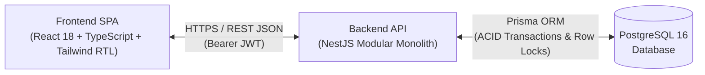

# Depoma — Inventory & Stock Ledger Management System

**Depoma** is a web-based Inventory Management System (IMS) built for small and medium-sized enterprises (SMEs). It replaces error-prone spreadsheet tracking with a centralized, multi-warehouse stock control platform backed by an **Immutable Inventory Ledger (`Stock_Movements`)** and a native **Persian (Farsi) Right-to-Left (RTL)** user interface.

---

## 1. Main Project Objectives

* **Transactional Inventory Accuracy:** Maintain a 100% verifiable audit trail where every stock addition (`IN`) or deduction (`OUT`) is recorded as an append-only ledger entry inside an ACID PostgreSQL transaction, using `SELECT ... FOR UPDATE` row-level locking to prevent negative balances and concurrent race conditions.
* **Server-Side Access Control & Warehouse Scoping:** Enforce Role-Based Access Control (`ADMIN`, `OPERATOR`, `MANAGER`) and restrict Warehouse Operators strictly to their assigned warehouses (`Warehouse_Operators`) on every backend endpoint.
* **Localized B2B User Experience:** Deliver a responsive Persian RTL interface with Jalali (Solar Hijri) calendar formatting at the presentation layer while preserving standardized `ISO 8601 UTC` (`TIMESTAMPTZ`) storage in the database.
* **Maintainable Modular Architecture:** Structure the backend as a **NestJS Modular Monolith** with strict domain boundaries (`Auth`, `Users`, `Catalog`, `Warehouses`, `Inventory`, `Dashboard`) ready for future Multi-Tenant SaaS evolution.

---

## 2. Core MVP Features

1. **Authentication & Session Management:** JWT-based sign-in, sign-out, and live database verification of user active status and roles.
2. **User & Warehouse Operator Assignment:** Admin provisioning of users and explicit mapping of `OPERATOR` accounts to authorized warehouses (`Warehouse_Operators`).
3. **Product & Category Catalog:** Standardized item catalog with unique `SKU` codes, measurement units, and per-warehouse `minimum_stock` alert thresholds.
4. **Multi-Warehouse Management:** Creation and management of physical storage facilities (`Warehouses`).
5. **Concurrency-Safe Stock Receipts (`Stock In`) & Stock Issues (`Stock Out`):** Atomic balance updates paired with immutable ledger entries and strict prevention of stock issues exceeding available warehouse balances (`422 Unprocessable Entity`).
6. **Immutable Movement History (Audit Ledger):** Filterable chronological log of all stock movements with resulting balances (`balance_after`), reasons, voucher references, and operator attribution.
7. **Operational Dashboard:** Real-time KPI summary cards, low-stock threshold alerts, and recent warehouse activity feed.

---

## 3. Technology Stack

| Layer | Technologies |
| :--- | :--- |
| **Frontend SPA** | React 18, TypeScript, Vite, Tailwind CSS (`RTL`), shadcn/ui, TanStack Query, React Hook Form, Zod |
| **Backend API** | Node.js, NestJS (Modular Monolith), TypeScript, Passport-JWT, bcrypt, class-validator |
| **Database & ORM** | PostgreSQL 16 (`TIMESTAMPTZ` UTC, ACID Transactions, Row Locking), Prisma ORM |
| **Testing & DevOps** | Jest, Supertest, Playwright, ESLint, Prettier, Docker Compose |

---

## 4. High-Level System Architecture

Detailed architectural views (UML Use Case, UML Activity, System Architecture, and ERD) are maintained in [`docs/phase-02-16-20-aban-diagrams-erd/diagrams/ALL_DIAGRAMS.md`](./docs/phase-02-16-20-aban-diagrams-erd/diagrams/ALL_DIAGRAMS.md).

---

## 5. Work Plan & Phase Documentation (`docs/`)

All engineering specifications and phase deliverables are structured into dedicated phase directories matching the official semester work plan (`Software_Engineering_Semester_Project_Final.pdf` Section 7).

* 📚 **[Central Documentation Directory Index (`docs/README.md`)](./docs/README.md)**

### Completed Phase Directories (Analysis & Design Milestone):
* 📁 **[Phase 01: 9–15 Aban — MVP Definition & User Stories](./docs/phase-01-9-15-aban-mvp-user-stories/README.md)**
  - [`PRD.md`](./docs/phase-01-9-15-aban-mvp-user-stories/PRD.md) — Problem statement, target users, roles, MoSCoW MVP boundaries, and core workflow.
  - [`USER_STORIES.md`](./docs/phase-01-9-15-aban-mvp-user-stories/USER_STORIES.md) — Prioritized user stories with observable and testable acceptance criteria.
  - [`REQUIREMENTS_TRACEABILITY.md`](./docs/phase-01-9-15-aban-mvp-user-stories/REQUIREMENTS_TRACEABILITY.md) — Requirements-to-code traceability matrix.
* 📁 **[Phase 02: 16–20 Aban — System Diagrams & Initial ERD](./docs/phase-02-16-20-aban-diagrams-erd/README.md)**
  - [`diagrams/ALL_DIAGRAMS.md`](./docs/phase-02-16-20-aban-diagrams-erd/diagrams/ALL_DIAGRAMS.md) — 4 required design views (Use Case, Activity, System Architecture, ERD).
  - [`DATABASE_DESIGN.md`](./docs/phase-02-16-20-aban-diagrams-erd/DATABASE_DESIGN.md) — PostgreSQL schema, constraints, indexes, transactional locking, and `schema.prisma`.
  - [`ARCHITECTURE.md`](./docs/phase-02-16-20-aban-diagrams-erd/ARCHITECTURE.md) — Modular Monolith architecture, DAG module rules, live JWT check, and SaaS roadmap.
* 📁 **[Phase 03: 21–24 Aban — Prototype, API Contracts & Hosting Plan](./docs/phase-03-21-24-aban-prototype-api-hosting/README.md)**
  - [`PROTOTYPE_SPECIFICATION.md`](./docs/phase-03-21-24-aban-prototype-api-hosting/PROTOTYPE_SPECIFICATION.md) — Persian RTL design system and 8-frame clickable prototype blueprint.
  - [`API_SPECIFICATION.md`](./docs/phase-03-21-24-aban-prototype-api-hosting/API_SPECIFICATION.md) — 24 REST endpoints, request/response envelopes, and error codes.
  - [`HOSTING_PLAN.md`](./docs/phase-03-21-24-aban-prototype-api-hosting/HOSTING_PLAN.md) — Cloud provider evaluation, resource limits, and monthly cost estimates.
  - [`DEVELOPMENT_GUIDELINES.md`](./docs/phase-03-21-24-aban-prototype-api-hosting/DEVELOPMENT_GUIDELINES.md) — Coding standards, testing strategy, and Git workflow.
  - [`PROJECT_PLAN.md`](./docs/phase-03-21-24-aban-prototype-api-hosting/PROJECT_PLAN.md) — Work plan mapping and milestone execution plan.

### Future Phase Directories (`Planned / Not Started`):
* 📁 **[Phase 04: 27 Aban–7 Azar — Setup & Initial Integration](./docs/phase-04-27-aban-7-azar-setup-integration/README.md)**
* 📁 **[Phase 05: 8–14 Azar — Auth & Core Workflow](./docs/phase-05-8-14-azar-auth-core-workflow/README.md)**
* 📁 **[Phase 06: 15–22 Azar — Testing & Demo Rehearsal](./docs/phase-06-15-22-azar-test-and-demo/README.md)**
* 📁 **[Phase 07: 25 Azar–17 Dey — Complete Must-Have Features](./docs/phase-07-25-azar-17-dey-must-have-features/README.md)**
* 📁 **[Phase 08: 18–24 Dey — Deploy & Bug Fixes](./docs/phase-08-18-24-dey-deploy-and-bug-fixes/README.md)**
* 📁 **[Phase 09: 25–30 Dey — Code Freeze & Final Docs](./docs/phase-09-25-30-dey-code-freeze-docs/README.md)**
* 📁 **[Phase 10: 1–3 Bahman — Final Verification & Submission](./docs/phase-10-1-3-bahman-final-verification/README.md)**

> 🔗 **Interactive Figma Prototype:**  
> `[Pending — Insert public Figma prototype URL here]`

---

## 6. Engineering Team & Ownership

* **Frontend Lead:** `[Insert Team Member 1 Full Name]` — UI/UX & Figma Prototype, React/TypeScript RTL Client, Form Validation, and E2E Testing.
* **Backend & Database Lead:** `[Insert Team Member 2 Full Name]` — PostgreSQL & Prisma Schema, NestJS Modular Monolith API, Authentication/Authorization Guards, Inventory Ledger Engine, and Cloud Deployment.
