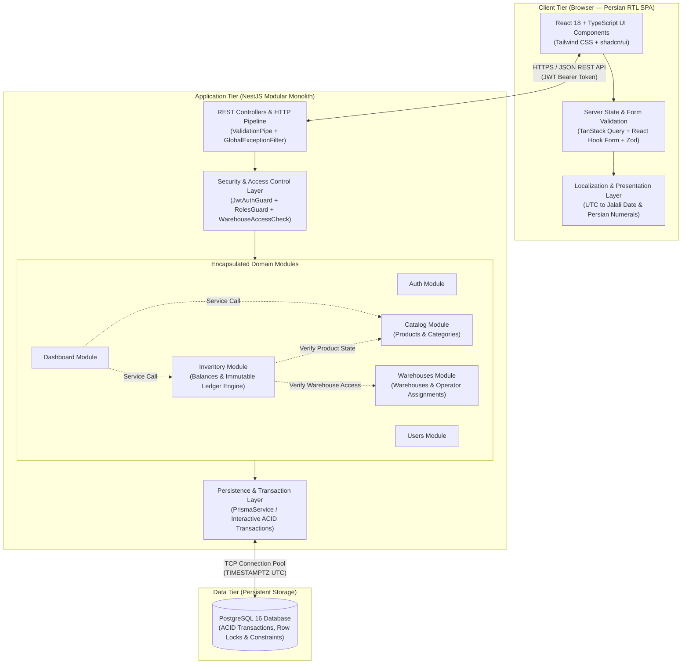

# Software Architecture Document

**Product Name:** Depoma — Inventory & Stock Ledger Management System  
**Document Version:** 1.0  
**Architectural Pattern:** Modular Monolith (Backend) + Component-Driven SPA (Frontend)  

---

## 1. High-Level System Architecture

Depoma is engineered as a modern three-tier web application consisting of a **React Single-Page Application (SPA)** client, a **NestJS Modular Monolith** REST API server, and a **PostgreSQL** relational database.



---

## 2. Architectural Style & Rationale: Why Modular Monolith?

Depoma's backend is built as a **Modular Monolith** rather than a distributed microservices architecture or an unstructured layered monolith.

### 2.1. Engineering Justification
1. **Strong Transactional Consistency (ACID Ledger Guarantees):** Recording a stock movement requires verifying warehouse operator permissions, checking product status, locking the current balance row, updating `inventory_balances`, and appending a record to `stock_movements`. In a Modular Monolith backed by a single PostgreSQL instance, these steps execute inside a native ACID database transaction with zero network-hop overhead or distributed saga complexity.
2. **Strict Domain Encapsulation:** Unlike a traditional monolith where controllers or services arbitrarily query any table, each business capability is isolated inside a dedicated NestJS module with explicit public service interfaces.
3. **Operational Simplicity & Cost Efficiency:** Deploying a single stateless backend container and a single PostgreSQL database minimizes DevOps overhead, eliminates inter-service serialization latency, and reduces cloud infrastructure costs.
4. **Seamless Evolution Path:** Because module boundaries are strictly enforced at the application layer, high-throughput domains can be extracted into standalone services in the future without rewriting core business logic.

### 2.2. Architectural Trade-Off Analysis

| Evaluation Criterion | Unstructured Monolith | **Modular Monolith (Selected)** | Microservices |
| :--- | :---: | :---: | :---: |
| **Development Velocity** | High initially, degrades rapidly | **High and sustained** | Low (high infrastructure overhead) |
| **ACID Transaction Integrity** | Native | **Native (Single DB Transaction)** | Complex (Eventual Consistency / Sagas) |
| **Module Boundary Enforcement** | Weak / None | **Strict (Explicit Module Exports)** | Strict (Network Boundaries) |
| **Operational & Hosting Cost** | Low | **Low (Single App + Single DB)** | High (Multiple runtimes, brokers, gateways) |
| **Testability (Integration/E2E)** | Moderate | **High (In-process module testing)** | Complex (Requires service mocking/orchestration) |

---

## 3. Backend Architecture & Module Boundaries

### 3.1. Core Domain Modules
The backend is partitioned into six focused domain modules. Non-essential modules (such as complex notification engines or external billing) are excluded from v1.0 to keep the codebase lean:

1. **`AuthModule`:** Handles credential verification (`/api/auth/login`), session termination (`/api/auth/logout`), JWT signing and verification, `Passport` strategies, and global authentication/role guards (`JwtAuthGuard`, `RolesGuard`).
2. **`UsersModule`:** Manages user lifecycle, `bcrypt` password hashing, and user lookup services exported to `AuthModule` and `WarehousesModule`.
3. **`CatalogModule`:** Manages `Categories` and `Products`, enforces `SKU` uniqueness, and exports read-only validation methods to verify whether a product is `ACTIVE`. To avoid circular dependencies, `CatalogModule` never imports `InventoryModule`.
4. **`WarehousesModule`:** Manages physical `Warehouses` and the `Warehouse_Operators` assignment table. Exports the critical security method `assertUserHasWarehouseAccess(user, warehouseId)` used by `InventoryModule` and `DashboardModule`.
5. **`InventoryModule`:** The core transactional engine. Owns `Inventory_Balances` and `Stock_Movements`. Executes atomic stock receipts (`IN`) and stock issues (`OUT`) inside interactive PostgreSQL transactions (`prisma.$transaction`) using raw SQL `INSERT ... ON CONFLICT DO UPDATE` for receipts and `SELECT ... FOR UPDATE` pessimistic row-level locking for issues.
6. **`DashboardModule`:** Aggregates read-only operational KPIs and recent movement feeds by orchestrating exported methods from `CatalogModule`, `WarehousesModule`, and `InventoryModule`.

### 3.2. Directed Acyclic Module Dependency Graph (No Circular Dependencies)
Module imports follow a strict one-way Directed Acyclic Graph (DAG):
* `DashboardModule` $\rightarrow$ `InventoryModule`, `CatalogModule`, `WarehousesModule`
* `InventoryModule` $\rightarrow$ `CatalogModule`, `WarehousesModule`
* `CatalogModule` & `WarehousesModule` $\rightarrow$ `UsersModule` (where user validation is required)
* `AuthModule` $\rightarrow$ `UsersModule`

Because `InventoryModule` depends on `CatalogModule`, **`CatalogModule` must never depend on `InventoryModule`**. Specifically, `GET /api/products/:id` in `CatalogModule` returns only product and category master data, while per-warehouse stock balances for a specific product are retrieved via `GET /api/inventory/balances?productId=:id` in `InventoryModule` (which enforces warehouse-level operator access).

### 3.2. Internal Module Layering
Each domain module follows a clean three-layer internal structure:
* **Presentation Layer (`*.controller.ts`, `dto/*.dto.ts`):** Handles HTTP routing, request parsing, and declarative input validation using `class-validator` and `class-transformer`. Controllers contain **zero business logic**.
* **Application / Domain Service Layer (`*.service.ts`):** Implements domain rules, authorization/ownership checks, error throwing, and transaction boundaries.
* **Data Access Layer (`PrismaService`):** Executes type-safe SQL queries and interactive transactions against PostgreSQL.

### 3.3. Inter-Module Communication Rules
To preserve modular integrity, the following architectural rules are enforced during code reviews:
* **Rule 1 (Table Ownership):** Each database table is owned by a single module for write operations. For example, `InventoryModule` is strictly prohibited from writing to `products`, `warehouses`, or `warehouse_operators`.
* **Rule 2 (Communication via Exported Services Only):** Modules interact exclusively by injecting services explicitly listed in another module's `exports` array.

---

## 4. Frontend Architecture & RTL Localization

The client application is a responsive Single-Page Application built with **React 18, TypeScript, Vite, Tailwind CSS, and shadcn/ui**.

### 4.1. Frontend Architectural Principles
1. **Feature-Sliced Organization:** Code is organized by domain feature (`features/auth`, `features/dashboard`, `features/catalog`, `features/warehouses`, `features/inventory`) alongside shared foundational UI primitives (`components/ui`) and layout shells (`components/layout`).
2. **Declarative Server-State Management (`TanStack Query`):** All API fetches, loading states, error states, and cache invalidations are managed via React Query hooks. Recording a Stock Out mutation automatically invalidates `['inventory-balances']`, `['inventory-movements']`, and `['dashboard-summary']`, ensuring instant UI consistency.
3. **Schema-Driven Form Validation (`React Hook Form` + `Zod`):** Every data-entry form validates inputs client-side using Zod schemas before dispatching network requests, rendering clear Persian validation feedback.
4. **Native Persian RTL & Jalali Date Architecture (i18n-Ready):**
   - The root document is configured with `<html lang="fa" dir="rtl">`.
   - Components use CSS Logical Properties (`ms-*`, `me-*`, `ps-*`, `pe-*`, `text-start`, `border-s-*`) instead of physical directional classes (`ml-*`, `mr-*`). This allows future LTR English support without refactoring component layouts.
   - **Strict UTC-to-Jalali Boundary:** The frontend sends and receives all timestamps as standard `ISO 8601 UTC` strings. Conversion to the **Jalali (Solar Hijri)** calendar and Persian digits happens exclusively in the presentation layer via a centralized formatter utility (`src/lib/date.ts`).

---

## 5. Repository & Directory Structure

Depoma uses a clean monorepo layout housing documentation, backend, frontend, and Docker configuration:

```text
Depoma/
├── docs/
│   └── diagrams/                   # Mermaid (.mmd) and PlantUML (.puml) architecture diagrams
├── backend/                        # NestJS Modular Monolith API
│   ├── prisma/
│   │   ├── schema.prisma           # PostgreSQL schema and constraints
│   │   ├── migrations/             # Versioned SQL migrations
│   │   └── seed.ts                 # Initial Admin, Operators, Warehouses, and Catalog seed
│   ├── src/
│   │   ├── common/                 # Global guards, exception filters, custom decorators
│   │   ├── prisma/                 # Global PrismaModule and PrismaService
│   │   ├── modules/
│   │   │   ├── auth/               # AuthController, AuthService, JwtStrategy, RolesGuard
│   │   │   ├── users/              # UsersController, UsersService
│   │   │   ├── catalog/            # Products & Categories controllers and services
│   │   │   ├── warehouses/         # Warehouses & Operator assignment services
│   │   │   ├── inventory/          # Ledger engine, balances, receipts, issues
│   │   │   └── dashboard/          # KPI aggregation service
│   │   ├── app.module.ts
│   │   └── main.ts
│   └── test/                       # Unit and API integration test suites (Jest + Supertest)
├── frontend/                       # React + TypeScript + Vite SPA
│   ├── src/
│   │   ├── api/                    # Axios instance, interceptors, and typed API clients
│   │   ├── components/
│   │   │   ├── layout/             # RTL AppShell, Sidebar, Header, RoleProtectedRoute
│   │   │   └── ui/                 # Reusable shadcn/ui primitives (Button, Table, Modal, Alert)
│   │   ├── features/
│   │   │   ├── auth/               # Login view and session provider
│   │   │   ├── dashboard/          # KPI cards and recent activity feed
│   │   │   ├── catalog/            # Product and category management views
│   │   │   ├── warehouses/         # Warehouse list and operator assignment modal
│   │   │   └── inventory/          # Balances table, Stock In/Out modals, Movement ledger view
│   │   ├── lib/
│   │   │   ├── date.ts             # UTC to Jalali formatter and Persian numeral converter
│   │   │   └── utils.ts
│   │   └── main.tsx
│   └── e2e/                        # Playwright End-to-End user journey tests
├── docker-compose.yml              # Local PostgreSQL 16 container definition
└── *.md                            # Core engineering specifications
```

---

## 6. Security Architecture: Authentication & Multi-Layer Authorization

Security is enforced strictly on the backend across three sequential verification layers:

1. **Layer 1 — Identity & Live Status Verification (`JwtAuthGuard` + `JwtStrategy.validate()`):**
   - Credentials are verified against `bcrypt` password hashes (`cost factor >= 10`).
   - Upon sign-in, the server issues a signed JWT containing `{ sub: user.id, email: user.email, role: user.role }`.
   - **Protection Against Stale JWT Claims:** To ensure that user deactivation (`status = 'INACTIVE'`) or role changes (`PATCH /api/users/:id`) take effect immediately without waiting for JWT expiration, `JwtStrategy.validate(payload)` executes a fast indexed primary-key lookup (`UsersService.findActiveById(payload.sub)`) on every authenticated request:
     - If the user does not exist or `user.status !== 'ACTIVE'`, `JwtStrategy.validate()` throws `UnauthorizedException` (`401`) or `ForbiddenException` (`403`), immediately revoking access.
     - The `request.user` context is populated with the **fresh `role` and `status` read from the database**, rather than trusting potentially stale role claims inside the token payload.
2. **Layer 2 — Role-Based Access Control (`RolesGuard`):**
   - Endpoints declare required roles via `@Roles(UserRole.ADMIN, UserRole.OPERATOR)`.
   - `RolesGuard` evaluates the fresh `request.user.role` loaded by `JwtStrategy.validate()`. Users with the `MANAGER` role are restricted to `GET` endpoints; any attempt to invoke `POST`, `PATCH`, or `DELETE` routes is rejected with `403 Forbidden` (`FORBIDDEN_ROLE`).
3. **Layer 3 — Resource-Level Warehouse Ownership (`WarehouseAccessCheck`):**
   - Whenever a user with `role === 'OPERATOR'` requests balances (`GET /api/inventory/balances`), movement history (`GET /api/inventory/movements`), warehouse details (`GET /api/warehouses/:id`), or submits a Stock In / Stock Out operation for a specific `warehouseId`, the backend queries `warehouse_operators` for `{ userId: currentUser.id, warehouseId }`.
   - If no assignment record exists, the backend immediately aborts execution with `403 Forbidden` (`FORBIDDEN_WAREHOUSE_ACCESS`), preventing horizontal privilege escalation via API parameter tampering.

---

## 7. Standardized Exception Handling

A global NestJS exception filter (`GlobalExceptionFilter`) intercepts all validation, domain, and database errors, returning a deterministic JSON contract to the client (where `errorCode` provides a stable programmatic identifier and `message` provides the localized Persian string rendered directly in the RTL user interface):

```json
{
  "statusCode": 422,
  "errorCode": "INSUFFICIENT_STOCK",
  "message": "موجودی کالا در این انبار کافی نیست. موجودی قابل دسترس: ۱۲ عدد، مقدار درخواستی: ۲۰ عدد.",
  "details": {
    "availableQuantity": 12,
    "requestedQuantity": 20,
    "productId": "p1000000-0000-4000-8000-000000000001",
    "warehouseId": "w1000000-0000-4000-8000-000000000001"
  },
  "timestamp": "2026-11-08T18:30:00.000Z",
  "path": "/api/inventory/issues"
}
```

---

## 8. Future Scalability & Multi-Tenancy Roadmap (SaaS Evolution)

### 8.1. Single-Tenant Scope in v1.0
In v1.0, Depoma is deployed as a single-organization system without `tenant_id` columns in the database schema. This deliberate architectural decision keeps the initial data model, indexing strategy, and transactional ledger engine focused on core inventory reliability while supporting immediate private deployments for individual SMEs.

### 8.2. Architectural Path to Multi-Tenant SaaS (v2.0+)
The Modular Monolith architecture is designed to transition into a **Shared-Database, Shared-Schema Multi-Tenant SaaS** platform through three non-destructive steps:

1. **Tenant Entity & Schema Augmentation:**
   - Introduce an `organizations` (`tenants`) table (`id`, `name`, `slug`, `subscription_plan`, `status`, `created_at`).
   - Add a non-nullable `organization_id` foreign key to `users`, `warehouses`, `categories`, `products`, `inventory_balances`, and `stock_movements`.
   - Convert global unique constraints into tenant-scoped composite unique constraints—e.g., `UNIQUE (organization_id, sku)` on `products` and `UNIQUE (organization_id, code)` on `warehouses`.
2. **Cryptographic Tenant Context Propagation:**
   - Embed `organizationId` inside the signed JWT payload upon authentication. `organizationId` is never accepted from client request bodies or query parameters.
   - Use Node.js `AsyncLocalStorage` combined with a **Prisma Client Extension** to automatically inject `where: { organizationId }` into all queries and mutations.
3. **Database-Level Defense-in-Depth (PostgreSQL RLS):**
   - Enable PostgreSQL **Row-Level Security (RLS)** policies on all tenant-scoped tables tied to `current_setting('app.current_organization_id')`, guaranteeing strict data isolation between companies even in the event of an application-layer query bug.
   - For enterprise customers requiring physical data isolation, the containerized application can be deployed in dedicated single-tenant mode using isolated `DATABASE_URL` instances.
