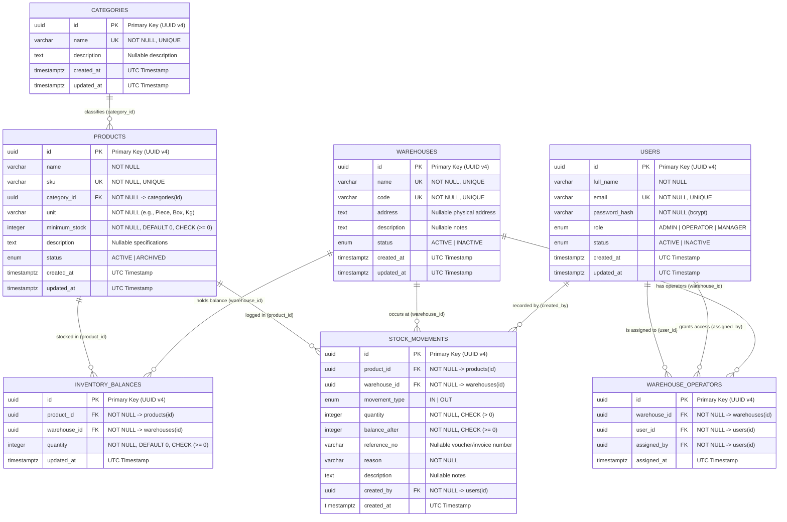

# Database Design & Inventory Ledger Specification

**Product Name:** Depoma — Inventory & Stock Ledger Management System  
**Database Engine:** PostgreSQL 16+  
**ORM / Data Access:** Prisma ORM  
**Document Version:** 1.0  

---

## 1. Core Data Modeling Principles

1. **Immutable Inventory Ledger (`stock_movements`):** Stock quantities are never modified by arbitrarily overwriting a number on a product record. Every change to physical stock must be recorded as an immutable, append-only row in `stock_movements` (`IN` or `OUT` in v1.0 MVP). The `inventory_balances` table serves as a materialized, real-time snapshot updated atomically within the same ACID database transaction.
2. **Standardized UTC Timestamp Storage:** All date and time columns use PostgreSQL `TIMESTAMPTZ` (Timestamp with Time Zone) stored strictly in **UTC**. Conversion to the Jalali calendar is performed exclusively in the frontend presentation layer, preserving chronological sorting, indexing, and cross-system interoperability.
3. **Referential Integrity & Soft Deactivation:** Master records (`users`, `warehouses`, `categories`, `products`) referenced by historical ledger movements are protected by `ON DELETE RESTRICT` foreign keys. Records that are no longer active transition to `INACTIVE` or `ARCHIVED` status rather than being physically deleted.
4. **Granular Warehouse Access Control (`warehouse_operators`):** Operator permissions are modeled explicitly via the `warehouse_operators` join table, enforcing a many-to-many relationship between `OPERATOR` users and `warehouses` with full audit metadata (`assigned_by`, `assigned_at`).

---

## 2. Entity-Relationship Diagram (ERD)



---

## 3. Table & Column Specifications

### 3.1. Database Enumerations
* **`UserRole`:** `'ADMIN'`, `'OPERATOR'`, `'MANAGER'`
* **`RecordStatus`:** `'ACTIVE'`, `'INACTIVE'`, `'ARCHIVED'`
* **`MovementType`:** `'IN'` (Stock Receipt), `'OUT'` (Stock Issue)
  *(Architectural Note on Adjustments: Dedicated adjustment endpoints are deferred out of the v1.0 MVP; stocktaking surpluses and deficits in v1.0 use `'IN'` and `'OUT'` movements with explicit adjustment reasons. When dedicated adjustment types are introduced in future releases, directional enums `'ADJUSTMENT_IN'` and `'ADJUSTMENT_OUT'` will be used rather than an unsigned `'ADJUSTMENT'` value, preserving the invariant $\sum \text{IN} - \sum \text{OUT} = \text{balance}$).*

---

### 3.2. `users` Table
Stores user credentials, system-wide role assignments, and account status. *(Architectural Note: Because each user holds exactly one system role, modeling `role` as a native PostgreSQL enum column on `users` avoids unnecessary join overhead during JWT authentication while keeping authorization checks fast and explicit).*

| Column Name | Data Type | Constraints | Description |
| :--- | :--- | :--- | :--- |
| `id` | `UUID` | `PRIMARY KEY`, `DEFAULT gen_random_uuid()` | Unique user identifier |
| `full_name` | `VARCHAR(120)` | `NOT NULL` | Full display name (Persian) |
| `email` | `VARCHAR(255)` | `NOT NULL`, `UNIQUE` | Unique login email address |
| `password_hash` | `VARCHAR(255)` | `NOT NULL` | `bcrypt` hashed password |
| `role` | `UserRole` | `NOT NULL`, `DEFAULT 'OPERATOR'` | Assigned RBAC role (`ADMIN`, `OPERATOR`, `MANAGER`) |
| `status` | `RecordStatus` | `NOT NULL`, `DEFAULT 'ACTIVE'` | Account state (`ACTIVE` or `INACTIVE`) |
| `created_at` | `TIMESTAMPTZ` | `NOT NULL`, `DEFAULT NOW()` | Creation timestamp (UTC) |
| `updated_at` | `TIMESTAMPTZ` | `NOT NULL` | Last modification timestamp (UTC) |

---

### 3.3. `warehouses` Table
Stores physical storage locations managed by the enterprise.

| Column Name | Data Type | Constraints | Description |
| :--- | :--- | :--- | :--- |
| `id` | `UUID` | `PRIMARY KEY`, `DEFAULT gen_random_uuid()` | Unique warehouse identifier |
| `name` | `VARCHAR(120)` | `NOT NULL`, `UNIQUE` | Warehouse display name |
| `code` | `VARCHAR(30)` | `NOT NULL`, `UNIQUE` | Short location code (e.g., `WH-THR-01`) |
| `address` | `TEXT` | `NULLABLE` | Physical street address |
| `description` | `TEXT` | `NULLABLE` | Operational notes |
| `status` | `RecordStatus` | `NOT NULL`, `DEFAULT 'ACTIVE'` | Operational state (`ACTIVE` or `INACTIVE`) |
| `created_at` | `TIMESTAMPTZ` | `NOT NULL`, `DEFAULT NOW()` | Creation timestamp (UTC) |
| `updated_at` | `TIMESTAMPTZ` | `NOT NULL` | Last modification timestamp (UTC) |

---

### 3.4. `warehouse_operators` Table
Enforces resource-level authorization by mapping which `OPERATOR` users are authorized to view and manage stock in which `warehouses`.

| Column Name | Data Type | Constraints | Description |
| :--- | :--- | :--- | :--- |
| `id` | `UUID` | `PRIMARY KEY`, `DEFAULT gen_random_uuid()` | Unique assignment identifier |
| `warehouse_id` | `UUID` | `NOT NULL`, `FK -> warehouses(id) ON DELETE CASCADE` | Target warehouse |
| `user_id` | `UUID` | `NOT NULL`, `FK -> users(id) ON DELETE CASCADE` | Assigned operator user |
| `assigned_by` | `UUID` | `NOT NULL`, `FK -> users(id) ON DELETE RESTRICT` | Admin user who granted the permission |
| `assigned_at` | `TIMESTAMPTZ` | `NOT NULL`, `DEFAULT NOW()` | Timestamp of assignment (UTC) |

* **Composite Unique Constraint:** `UNIQUE (warehouse_id, user_id)` prevents duplicate assignments.
* **Lookup Index:** `INDEX (user_id, warehouse_id)` accelerates per-request operator authorization checks.

---

### 3.5. `categories` Table
Groups products into logical classifications.

| Column Name | Data Type | Constraints | Description |
| :--- | :--- | :--- | :--- |
| `id` | `UUID` | `PRIMARY KEY`, `DEFAULT gen_random_uuid()` | Unique category identifier |
| `name` | `VARCHAR(100)` | `NOT NULL`, `UNIQUE` | Category name |
| `description` | `TEXT` | `NULLABLE` | Optional description |
| `created_at` | `TIMESTAMPTZ` | `NOT NULL`, `DEFAULT NOW()` | Creation timestamp (UTC) |
| `updated_at` | `TIMESTAMPTZ` | `NOT NULL` | Last modification timestamp (UTC) |

---

### 3.6. `products` Table
Defines the master catalog of items. Stock quantities are never stored directly on `products` because stock is tracked per warehouse in `inventory_balances`.

| Column Name | Data Type | Constraints | Description |
| :--- | :--- | :--- | :--- |
| `id` | `UUID` | `PRIMARY KEY`, `DEFAULT gen_random_uuid()` | Unique product identifier |
| `name` | `VARCHAR(150)` | `NOT NULL` | Product name |
| `sku` | `VARCHAR(64)` | `NOT NULL`, `UNIQUE` | Unique Stock Keeping Unit code |
| `category_id` | `UUID` | `NOT NULL`, `FK -> categories(id) ON DELETE RESTRICT` | Parent category reference |
| `unit` | `VARCHAR(30)` | `NOT NULL` | Base unit of measure (Piece, Box, Kg, etc.) |
| `minimum_stock` | `INTEGER` | `NOT NULL`, `DEFAULT 0`, `CHECK (minimum_stock >= 0)` | Low-stock alert threshold per warehouse |
| `description` | `TEXT` | `NULLABLE` | Technical specifications or notes |
| `status` | `RecordStatus` | `NOT NULL`, `DEFAULT 'ACTIVE'` | Catalog status (`ACTIVE` or `ARCHIVED`) |
| `created_at` | `TIMESTAMPTZ` | `NOT NULL`, `DEFAULT NOW()` | Creation timestamp (UTC) |
| `updated_at` | `TIMESTAMPTZ` | `NOT NULL` | Last modification timestamp (UTC) |

---

### 3.7. `inventory_balances` Table
Maintains the current available quantity of each product in each warehouse for fast operational queries and row-level transactional locking.

| Column Name | Data Type | Constraints | Description |
| :--- | :--- | :--- | :--- |
| `id` | `UUID` | `PRIMARY KEY`, `DEFAULT gen_random_uuid()` | Unique balance record identifier |
| `product_id` | `UUID` | `NOT NULL`, `FK -> products(id) ON DELETE RESTRICT` | Referenced product |
| `warehouse_id` | `UUID` | `NOT NULL`, `FK -> warehouses(id) ON DELETE RESTRICT` | Referenced warehouse |
| `quantity` | `INTEGER` | `NOT NULL`, `DEFAULT 0`, `CHECK (quantity >= 0)` | Current available stock (non-negative) |
| `updated_at` | `TIMESTAMPTZ` | `NOT NULL`, `DEFAULT NOW()` | Timestamp of last stock movement (UTC) |

* **Composite Unique Constraint:** `UNIQUE (product_id, warehouse_id)` guarantees at most one balance row per product per warehouse.
* **Database Check Constraint:** `CHECK (quantity >= 0)` enforces non-negative inventory at the database engine level as a final safeguard.

---

### 3.8. `stock_movements` Table (Immutable Ledger)
Append-only audit log recording every inventory transaction across all warehouses.

| Column Name | Data Type | Constraints | Description |
| :--- | :--- | :--- | :--- |
| `id` | `UUID` | `PRIMARY KEY`, `DEFAULT gen_random_uuid()` | Unique movement transaction ID |
| `product_id` | `UUID` | `NOT NULL`, `FK -> products(id) ON DELETE RESTRICT` | Moved product |
| `warehouse_id` | `UUID` | `NOT NULL`, `FK -> warehouses(id) ON DELETE RESTRICT` | Target warehouse |
| `movement_type` | `MovementType` | `NOT NULL` | Operation type (`IN`, `OUT`) |
| `quantity` | `INTEGER` | `NOT NULL`, `CHECK (quantity > 0)` | Absolute quantity moved (strictly positive integer) |
| `balance_after` | `INTEGER` | `NOT NULL`, `CHECK (balance_after >= 0)` | Resulting warehouse balance immediately after this movement |
| `reference_no` | `VARCHAR(64)` | `NULLABLE` | External voucher, invoice, or PO reference |
| `reason` | `VARCHAR(120)` | `NOT NULL` | Business reason for the movement |
| `description` | `TEXT` | `NULLABLE` | Additional operator remarks |
| `created_by` | `UUID` | `NOT NULL`, `FK -> users(id) ON DELETE RESTRICT` | User who executed the transaction |
| `created_at` | `TIMESTAMPTZ` | `NOT NULL`, `DEFAULT NOW()` | Exact execution timestamp (UTC) |

---

## 4. Indexing Strategy

| Table | Indexed Columns | Index Type | Query Optimization Purpose |
| :--- | :--- | :---: | :--- |
| `users` | `(email)` | `UNIQUE BTREE` | Fast credential lookup during sign-in |
| `products` | `(sku)` | `UNIQUE BTREE` | SKU uniqueness enforcement and exact code lookup |
| `products` | `(category_id, status)` | `BTREE` | Filtering active products by category |
| `warehouse_operators` | `(user_id, warehouse_id)` | `UNIQUE BTREE` | O(log n) verification of operator warehouse access |
| `inventory_balances` | `(warehouse_id, product_id)` | `UNIQUE BTREE` | Instant balance lookup and row locking per warehouse |
| `stock_movements` | `(warehouse_id, created_at DESC)` | `BTREE` | Chronological ledger pagination filtered by warehouse |
| `stock_movements` | `(product_id, created_at DESC)` | `BTREE` | Item cardex / movement history per product |

---

## 5. Transactional Ledger Execution & Concurrency Control

To guarantee that `inventory_balances` and `stock_movements` never drift out of sync, that product/warehouse active states cannot become stale between validation and mutation, and that concurrent requests cannot cause negative balances, all stock operations execute inside interactive ACID transactions (`prisma.$transaction`).

### 5.0. Why Standard Prisma `.findUnique()` Is Insufficient for Concurrent Stock Operations
Prisma's standard `.findUnique()` executes a non-locking `SELECT`, and standard `.upsert()` can encounter race conditions (`P2002` unique constraint errors) under simultaneous first-time inserts. Therefore:
1. **In-Transaction Active-State Validation:** Both `Stock In` and `Stock Out` verify `warehouse.status === 'ACTIVE'`, `product.status === 'ACTIVE'`, and operator warehouse assignment *inside* the `prisma.$transaction` callback before mutating balances, eliminating Time-of-Check to Time-of-Use (TOCTOU) races if an Admin deactivates a warehouse or archives a product concurrently.
2. **Atomic Upsert for `Stock In`:** Uses parameterized `tx.$queryRaw` executing PostgreSQL's native `INSERT INTO inventory_balances ... ON CONFLICT (product_id, warehouse_id) DO UPDATE SET quantity = inventory_balances.quantity + EXCLUDED.quantity RETURNING quantity`, which is concurrency-safe in PostgreSQL for both initial row creation and concurrent increments.
3. **Pessimistic Row-Level Locking for `Stock Out`:** Uses parameterized `tx.$queryRaw` executing `SELECT id, quantity FROM inventory_balances WHERE product_id = $1::uuid AND warehouse_id = $2::uuid FOR UPDATE` inside `prisma.$transaction`. Any concurrent transaction targeting the same `(product_id, warehouse_id)` blocks on the row lock until the first transaction commits or rolls back.

### 5.1. Atomic Stock Receipt Transaction (`Stock In`)
When receiving goods (`POST /api/inventory/receipts`), the product may either already have a balance row in that warehouse or be stocked there for the first time. An in-transaction validation followed by an atomic `UPSERT` and ledger `INSERT` handles both cases safely:

```sql
BEGIN TRANSACTION;

-- 1. Verify inside the transaction that target warehouse and product are ACTIVE
SELECT status FROM warehouses WHERE id = $2 FOR SHARE;
SELECT status FROM products WHERE id = $1 FOR SHARE;
-- (If either is missing or status != 'ACTIVE', ROLLBACK and return 422 INACTIVE_RESOURCE)

-- 2. Atomically insert initial balance or increment existing balance (Concurrency-Safe Upsert)
INSERT INTO inventory_balances (id, product_id, warehouse_id, quantity, updated_at)
VALUES (gen_random_uuid(), $1, $2, $3, NOW())
ON CONFLICT (product_id, warehouse_id)
DO UPDATE SET 
    quantity = inventory_balances.quantity + EXCLUDED.quantity,
    updated_at = NOW()
RETURNING quantity AS new_balance;

-- 3. Append immutable IN record to the stock ledger
INSERT INTO stock_movements (
    id, product_id, warehouse_id, movement_type, 
    quantity, balance_after, reference_no, reason, description, created_by, created_at
) VALUES (
    gen_random_uuid(), $1, $2, 'IN', 
    $3, new_balance, $4, $5, $6, $7, NOW()
);

COMMIT TRANSACTION;
```

### 5.2. Atomic Stock Issue Transaction with Row Locking (`Stock Out`)
When issuing goods (`POST /api/inventory/issues`), two operators might simultaneously attempt to withdraw stock from the same warehouse (e.g., `12` units available; Operator A requests `10` units and Operator B requests `8` units concurrently).

Depoma prevents race conditions using in-transaction state validation and pessimistic row-level locking (`SELECT ... FOR UPDATE`) via `tx.$queryRaw`:

```sql
BEGIN TRANSACTION;

-- 1. Verify inside the transaction that target warehouse and product are ACTIVE
SELECT status FROM warehouses WHERE id = $2 FOR SHARE;
SELECT status FROM products WHERE id = $1 FOR SHARE;
-- (If either is missing or status != 'ACTIVE', ROLLBACK and return 422 INACTIVE_RESOURCE)

-- 2. Acquire an exclusive row-level lock on the product's balance in the target warehouse.
-- Any concurrent transaction targeting the same (product_id, warehouse_id) blocks here
-- until this transaction commits or rolls back.
SELECT id, quantity 
FROM inventory_balances 
WHERE product_id = $1 AND warehouse_id = $2 
FOR UPDATE;

-- 3. Application-layer verification inside the open transaction:
-- If no row exists OR quantity < requested_quantity ($3):
-- ROLLBACK TRANSACTION and throw 422 Unprocessable Entity (INSUFFICIENT_STOCK).

-- 4. Deduct the issued quantity from the locked balance row
UPDATE inventory_balances
SET quantity = quantity - $3,
    updated_at = NOW()
WHERE product_id = $1 AND warehouse_id = $2
RETURNING quantity AS new_balance;

-- 5. Append immutable OUT record to the stock ledger with the resulting balance
INSERT INTO stock_movements (
    id, product_id, warehouse_id, movement_type, 
    quantity, balance_after, reference_no, reason, description, created_by, created_at
) VALUES (
    gen_random_uuid(), $1, $2, 'OUT', 
    $3, new_balance, $4, $5, $6, $7, NOW()
);

COMMIT TRANSACTION;
```

---

## 6. Reference Prisma Schema (`schema.prisma`)

```prisma
datasource db {
  provider = "postgresql"
  url      = env("DATABASE_URL")
}

generator client {
  provider = "prisma-client-js"
}

enum UserRole {
  ADMIN
  OPERATOR
  MANAGER
}

enum RecordStatus {
  ACTIVE
  INACTIVE
  ARCHIVED
}

enum MovementType {
  IN
  OUT
}

model User {
  id                  String              @id @default(uuid()) @db.Uuid
  fullName            String              @map("full_name") @db.VarChar(120)
  email               String              @unique @db.VarChar(255)
  passwordHash        String              @map("password_hash") @db.VarChar(255)
  role                UserRole            @default(OPERATOR)
  status              RecordStatus        @default(ACTIVE)
  createdAt           DateTime            @default(now()) @map("created_at") @db.Timestamptz()
  updatedAt           DateTime            @updatedAt @map("updated_at") @db.Timestamptz()

  assignedWarehouses  WarehouseOperator[] @relation("OperatorAssignments")
  grantedAssignments  WarehouseOperator[] @relation("AdminGrants")
  stockMovements      StockMovement[]

  @@map("users")
}

model Warehouse {
  id                  String              @id @default(uuid()) @db.Uuid
  name                String              @unique @db.VarChar(120)
  code                String              @unique @db.VarChar(30)
  address             String?             @db.Text
  description         String?             @db.Text
  status              RecordStatus        @default(ACTIVE)
  createdAt           DateTime            @default(now()) @map("created_at") @db.Timestamptz()
  updatedAt           DateTime            @updatedAt @map("updated_at") @db.Timestamptz()

  operators           WarehouseOperator[]
  balances            InventoryBalance[]
  movements           StockMovement[]

  @@map("warehouses")
}

model WarehouseOperator {
  id                  String    @id @default(uuid()) @db.Uuid
  warehouseId         String    @map("warehouse_id") @db.Uuid
  userId              String    @map("user_id") @db.Uuid
  assignedBy          String    @map("assigned_by") @db.Uuid
  assignedAt          DateTime  @default(now()) @map("assigned_at") @db.Timestamptz()

  warehouse           Warehouse @relation(fields: [warehouseId], references: [id], onDelete: Cascade)
  user                User      @relation("OperatorAssignments", fields: [userId], references: [id], onDelete: Cascade)
  assigner            User      @relation("AdminGrants", fields: [assignedBy], references: [id], onDelete: Restrict)

  @@unique([warehouseId, userId])
  @@index([userId, warehouseId])
  @@map("warehouse_operators")
}

model Category {
  id                  String    @id @default(uuid()) @db.Uuid
  name                String    @unique @db.VarChar(100)
  description         String?   @db.Text
  createdAt           DateTime  @default(now()) @map("created_at") @db.Timestamptz()
  updatedAt           DateTime  @updatedAt @map("updated_at") @db.Timestamptz()

  products            Product[]

  @@map("categories")
}

model Product {
  id                  String             @id @default(uuid()) @db.Uuid
  name                String             @db.VarChar(150)
  sku                 String             @unique @db.VarChar(64)
  categoryId          String             @map("category_id") @db.Uuid
  unit                String             @db.VarChar(30)
  minimumStock        Int                @default(0) @map("minimum_stock")
  description         String?            @db.Text
  status              RecordStatus       @default(ACTIVE)
  createdAt           DateTime           @default(now()) @map("created_at") @db.Timestamptz()
  updatedAt           DateTime           @updatedAt @map("updated_at") @db.Timestamptz()

  category            Category           @relation(fields: [categoryId], references: [id], onDelete: Restrict)
  balances            InventoryBalance[]
  movements           StockMovement[]

  @@index([categoryId, status])
  @@map("products")
}

model InventoryBalance {
  id                  String    @id @default(uuid()) @db.Uuid
  productId           String    @map("product_id") @db.Uuid
  warehouseId         String    @map("warehouse_id") @db.Uuid
  quantity            Int       @default(0)
  updatedAt           DateTime  @updatedAt @map("updated_at") @db.Timestamptz()

  product             Product   @relation(fields: [productId], references: [id], onDelete: Restrict)
  warehouse           Warehouse @relation(fields: [warehouseId], references: [id], onDelete: Restrict)

  @@unique([productId, warehouseId])
  @@index([warehouseId, productId])
  @@map("inventory_balances")
}

model StockMovement {
  id                  String       @id @default(uuid()) @db.Uuid
  productId           String       @map("product_id") @db.Uuid
  warehouseId         String       @map("warehouse_id") @db.Uuid
  movementType        MovementType @map("movement_type")
  quantity            Int
  balanceAfter        Int          @map("balance_after")
  referenceNo         String?      @map("reference_no") @db.VarChar(64)
  reason              String       @db.VarChar(120)
  description         String?      @db.Text
  createdBy           String       @map("created_by") @db.Uuid
  createdAt           DateTime     @default(now()) @map("created_at") @db.Timestamptz()

  product             Product      @relation(fields: [productId], references: [id], onDelete: Restrict)
  warehouse           Warehouse    @relation(fields: [warehouseId], references: [id], onDelete: Restrict)
  creator             User         @relation(fields: [createdBy], references: [id], onDelete: Restrict)

  @@index([warehouseId, createdAt(sort: Desc)])
  @@index([productId, createdAt(sort: Desc)])
  @@map("stock_movements")
}
```
