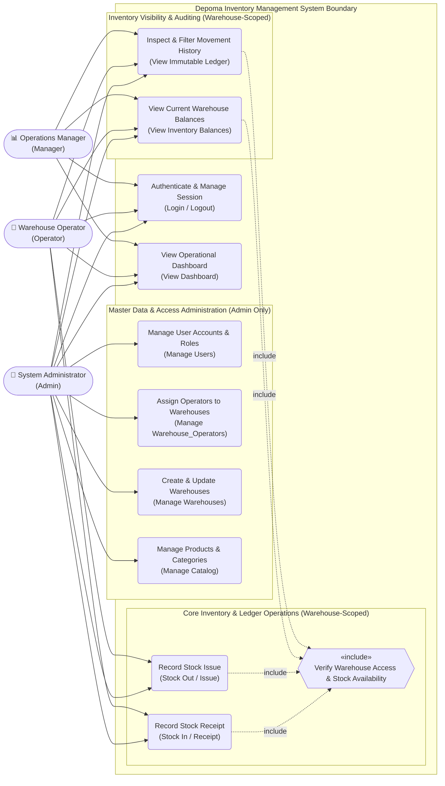
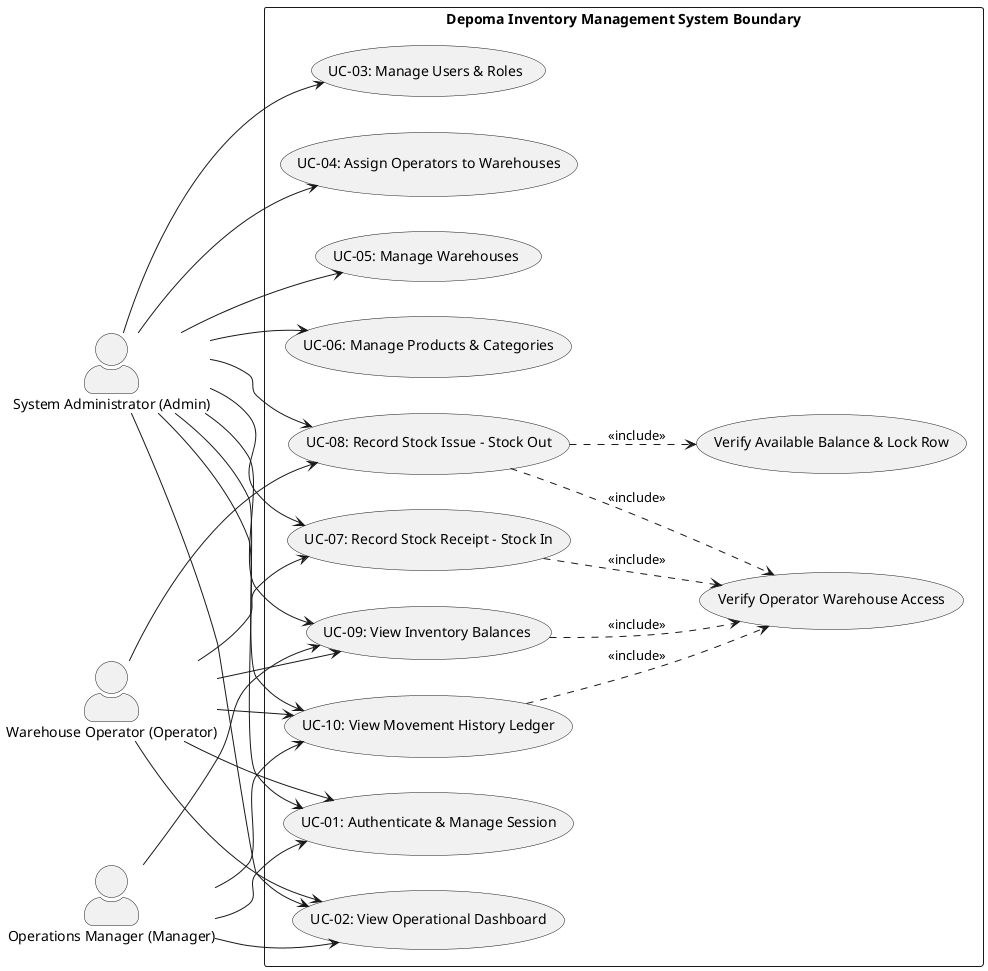
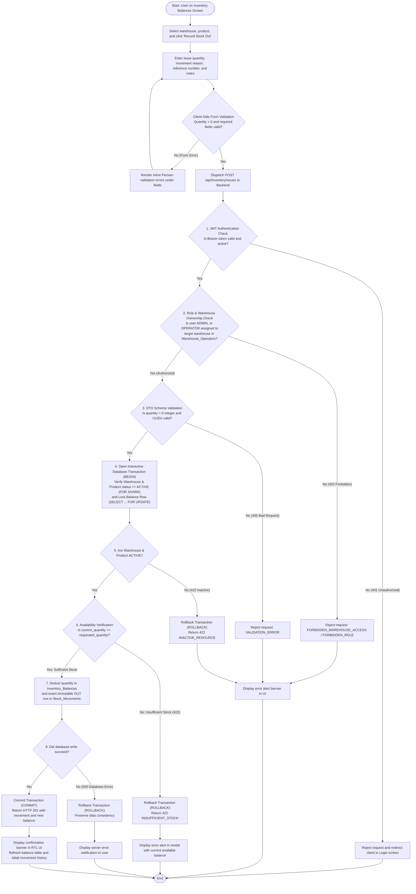
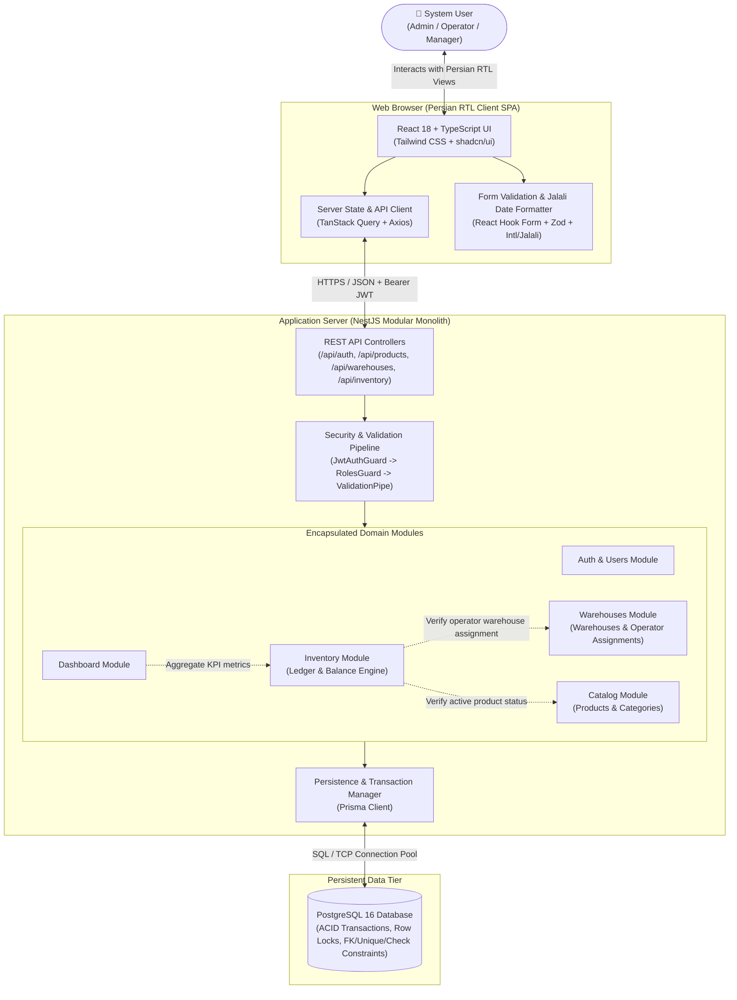
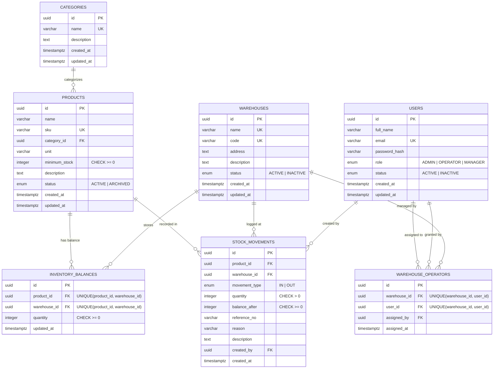

# System Design & Architecture Diagrams

**Product Name:** Depoma — Inventory & Stock Ledger Management System  
**Document Version:** 1.0  

This document consolidates the four core architectural views of the Depoma platform. Editable Mermaid (`.mmd`) and PlantUML (`.puml`) source files are maintained alongside this document in `docs/phase-02-16-20-aban-diagrams-erd/diagrams/`:
1. **UML Use Case Diagram** (Actor roles and system capabilities)
2. **UML Activity Diagram** (End-to-end Stock Out workflow with authorization, row locking, and error branches)
3. **System Architecture Diagram** (Client, Modular Monolith Backend, and PostgreSQL Database tiers)
4. **Entity-Relationship Diagram (ERD)** (Persistent relational schema, keys, and constraints)

---

## 1. UML Use Case Diagram

This view illustrates the interactions of the three system roles (`Admin`, `Warehouse Operator`, `Manager`) with Depoma's functional boundary.

### 1.1. Mermaid Diagram

### 1.2. PlantUML Specification (`use-case.puml`)

---

## 2. UML Activity Diagram — Record Stock Issue (Stock Out Workflow)

This diagram traces the primary business workflow (**Recording a Stock Issue / Stock Out**) across the client, backend security pipeline, and PostgreSQL transactional ledger, explicitly modeling all validation, permission, insufficient stock (`422`), and database failure paths.

---

## 3. System Architecture Diagram

---

## 4. Entity-Relationship Diagram (ERD)

