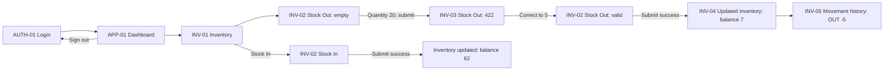

# Depoma — MVP UI/UX & Figma Prototype Specification

**Product:** Depoma — Inventory & Stock Ledger Management System
**Document version:** 3.0
**Status:** Figma-ready MVP screen and interaction blueprint
**UI language:** Persian (Farsi), native RTL (`lang="fa"`, `dir="rtl"`)
**Primary target:** Desktop web application; responsive tablet and mobile references included
**Implementation alignment:** React 18, TypeScript, Tailwind CSS (RTL), shadcn/ui, TanStack Query, React Hook Form, and Zod

This is the complete visual and interaction specification for the Depoma v1.0 MVP frontend. It continues the Auth, Dashboard, and Inventory work in Part 5a and specifies every additional MVP page, role variant, component, error/empty/loading state, responsive behavior, and Figma interaction needed to build a coherent, styled, clickable frontend. All displayed business capabilities are limited to the approved PRD, user stories, and API contract; deferred features are not part of this prototype.

---

## 1. Scope, Product Rules & Figma Deliverables

### 1.1 MVP capabilities that must appear in the UI

| Capability | Primary user(s) | Frontend surface |
| --- | --- | --- |
| Sign in, persist session, sign out | `ADMIN`, `OPERATOR`, `MANAGER` | Login, protected application shell, session-expired state |
| Operational KPIs and recent activity | All roles (data scoped for operators) | Dashboard |
| View per-warehouse stock; search/filter low stock | All roles (operator warehouse-scoped) | Inventory balances |
| Record stock receipt and issue | `ADMIN`, `OPERATOR` for authorized active warehouses only | Stock In / Stock Out forms and confirmation/error states |
| Browse, search, and inspect product catalog | All roles | Products tab and product detail |
| Manage categories and products | `ADMIN` | Catalog create/edit dialogs; archive product confirmation |
| Browse and inspect warehouses | All roles (operator sees assigned only) | Warehouses |
| Create/update/deactivate warehouse; assign/revoke operators | `ADMIN` | Warehouse form, warehouse detail, operator-access dialog |
| Provision users, change role/status | `ADMIN` | Users list, create/edit/status-confirmation dialogs |
| Inspect/filter immutable ledger | All roles (operator warehouse-scoped) | Movement history |
| Show validation, permission, conflict and server errors | Relevant users | Inline field errors, banners, toasts, error/empty states |

### 1.2 Explicitly out of scope (do not add prototype affordances)

- Inter-warehouse transfer, direct stock adjustment, purchase orders, sales/CRM, suppliers/customer portals, barcode/RFID, serial/lot/expiry tracking, shelf/bin management, CSV/Excel/PDF export, public registration, password reset, and multi-tenant organization switching.
- No hard-delete action for products, categories, warehouses, users, balances, or ledger records. Use the API-supported archive/inactive/account-status lifecycle; ledger entries are immutable.
- No chart/reporting controls implying analytics or exports beyond the defined dashboard KPIs, filters, and recent movement lists.

### 1.3 Figma file organization and delivery

Create these Figma pages in order:

1. `00 — Cover & Flow`: project title, role legend, scope note, prototype starting point, and top-level flow.
2. `01 — Foundations`: color/type/spacing variables, RTL grids, icon usage, elevation, responsive rules.
3. `02 — Components`: component set and state variants listed in Section 3.
4. `03 — Auth`: login default, validation, invalid-credentials, and inactive-account states.
5. `04 — Operator`: operator dashboard, inventory, Stock In/Out, 422, success, and ledger.
6. `05 — Admin`: admin dashboard plus Catalog, Warehouses, Users, and their create/edit/assignment states.
7. `06 — Manager`: read-only dashboard, inventory, catalog, warehouse, and ledger role variants.
8. `07 — Mobile`: 390px responsive references and mobile navigation/overflow patterns.
9. `08 — Prototype map`: named flow connections, error branches, and role entry points.

Use named components, variants, Auto Layout, constraints, local styles/variables, and consistent frame names. Use real Persian copy from this specification; use a consistent icon family (Lucide or equivalent), not emoji as production UI icons. Do not flatten components into screenshots. Annotate API-driven behavior with Figma descriptions or a nearby `Notes` component.

---

## 2. Design Foundations

### 2.1 Artboards, grid and application geometry

- **Desktop primary:** `1440 × 900`.
- **Desktop minimum design reference:** `1280 × 800`; the application remains usable without clipping the primary navigation or page actions.
- **Tablet reference:** `768 × 1024`.
- **Mobile reference:** `390 × 844`.
- Desktop right sidebar: `264px` fixed, full viewport height, right edge. Main area: `1176px` at 1440 width. Main top bar: `64px` sticky. Content scrolls independently, with `24px` vertical and `32px` horizontal padding. Use a 12-column content grid with `24px` gutters; avoid forcing wide tables into narrow columns.
- Main page content has a consistent title/action row, optional context/filter row, and content region. Use a centered max-width for narrow forms; dashboard and tables may use the full content width.
- Build with Auto Layout and constraints. Keep spacing to a 4px base scale. Prefer logical `start/end` and `inline/block` directions over hard-coded left/right in implementation handoff notes.

### 2.2 RTL, language, numbers, and date/time

- Set the app root to Persian and RTL. All Persian labels, navigation, table headers, form labels, dialogs, and messages are right-aligned; SKU, email, reference numbers, and other Latin identifiers remain LTR and use isolated direction (`dir="ltr"`).
- Font: **Vazirmatn**; fallback **IRANSansX**, then system sans-serif. Use `font-feature-settings: "ss01"` where supported. Buttons and controls inherit the Persian font.
- Render UI quantities and dates with Persian numerals. Keep API identifiers, SKU codes, emails, and reference numbers in their canonical Latin forms.
- Show dates in the Jalali calendar at the presentation layer only. API/database timestamps remain UTC ISO 8601. Use a full Jalali date and time in detailed ledger rows and a compact date/time in summaries. The sample date `۱۴۰۵/۰۸/۱۷` is illustrative fixture data, not a fixed system date; header date is current.
- Use unambiguous time presentation, e.g. `۱۴۰۵/۰۸/۱۷، ۱۸:۳۰`. When showing an absolute date to support auditability, do not replace it with a relative-only label such as “today”.

### 2.3 Typography

| Token | Use | Weight | Size / line height |
| --- | --- | ---: | ---: |
| `Display / Page` | Login hero or page heading | 700 | 24 / 36px |
| `Heading / Section` | Sections, dialog titles | 600–700 | 18–20 / 28–30px |
| `Heading / Card` | Card title, table section title | 600 | 16 / 24px |
| `Body / Default` | Body copy, table data, input value | 400 | 14 / 22px |
| `Body / Emphasis` | Labels, nav, buttons, selected values | 500–600 | 14 / 22px |
| `Caption` | Hint, metadata, SKU, timestamp, inline help | 400 | 12 / 18px |
| `Metric` | Dashboard KPI value | 800 | 28 / 36px |

Use a readable text contrast. Avoid using small caption text as the sole way to convey a critical status.

### 2.4 Color variables

| Variable | Hex | Use |
| --- | --- | --- |
| `canvas` | `#F8FAFC` | App content background |
| `surface` | `#FFFFFF` | Cards, table, header, dialogs |
| `sidebar` | `#0F172A` | Desktop navigation background |
| `text-primary` | `#0F172A` | Main text |
| `text-secondary` | `#475569` | Supporting text, table headings |
| `text-muted` | `#64748B` | Secondary metadata (ensure contrast) |
| `border` | `#E2E8F0` | Dividers, card/input borders |
| `brand` | `#1E40AF` | Primary actions, selected navigation, focus |
| `brand-soft` | `#DBEAFE` | Informational/role chip backgrounds |
| `success` | `#15803D` | Stock In, positive success |
| `success-soft` | `#DCFCE7` | Success state |
| `warning` | `#B45309` | Stock Out, low-stock and caution |
| `warning-soft` | `#FEF3C7` | Low-stock and outgoing badges |
| `danger` | `#B91C1C` | Destructive actions, errors, out-of-stock |
| `danger-soft` | `#FEE2E2` | Error background |
| `info-soft` | `#EFF6FF` | Balance/context information |

Do not rely on color alone: status badges also include Persian text and, where practical, an icon. Stock Out is a directional operation, not an error; use a restrained amber action and a clearly differentiated red error state.

### 2.5 Spacing, shape, elevation and iconography

- Spacing: `4, 8, 12, 16, 24, 32, 40, 48px`.
- Button/input radius: `8px`; cards/table container: `12px`; dialogs: `16px`; status chips: pill radius.
- Elevation: subtle card shadow only when raised above the canvas; use borders to define ordinary cards. Dialog uses a soft shadow and a `#0F172A` backdrop at approximately 50% opacity.
- Standard icon size: `20px`; compact inline icon: `16px`; brand mark: `32px`. Use one consistent outlined icon family and keep icons paired with labels for important actions.

---

## 3. Shared App Shell & Component Library

### 3.1 Desktop navigation and header

**Right sidebar (`264px`)**

- Brand block: 64px high; Depoma mark and `دپوما` with subtitle `سامانه مدیریت انبار`.
- Main navigation, in this order:
  1. `داشبورد` — `/dashboard`
  2. `موجودی و عملیات انبار` — `/inventory`
  3. `تاریخچه گردش کالا` — `/inventory/movements`
  4. `کالاها و دسته‌بندی‌ها` — `/products` (single Catalog destination with Products/Categories tabs)
  5. `انبارها` — `/warehouses`
  6. `مدیریت کاربران` — `/users`, **ADMIN only**
- Item height 44px, 8px radius, 16px inline padding. Active state uses `brand` fill and white text; default is muted light text on dark sidebar. Include an icon and visible label; active state is not color-only.
- `مدیریت کاربران` is omitted for `OPERATOR` and `MANAGER`. Other navigation destinations remain visible as permitted read-only views. Never present an unauthorized screen as an active menu destination.
- Bottom area: signed-in identity/role and a sign-out action, or place identity and sign-out in the top bar as below; do not duplicate both.

**Top bar (`64px`)**

- Right: current page title and compact breadcrumb (e.g. `دپوما / انبار / موجودی فعلی`).
- Left: current Jalali date chip; user avatar/initials, full name and localized role (`مدیر سیستم`, `اپراتور انبار`, `مدیر عملیات`); sign-out icon/button.
- Sign-out is a secondary/ghost action, with an optional confirmation dialog if the prototype includes it; session ends and route returns to Login. Never show credentials or tokens.

### 3.2 Mobile and tablet shell

- At `390px`, replace the fixed sidebar with a top app bar containing a menu button, page title/brand, and user/avatar control. The menu opens a full-height RTL drawer with the same role-filtered routes and sign-out.
- Content padding `16px`; stack KPI cards into one column (or a compact two-column layout only when labels remain readable). Form fields stack. Dialogs become near-full-screen sheets with a sticky action footer and a visible close control.
- Tables must not silently truncate important fields. Use horizontal scrolling with a persistent first product/reference column where feasible, or convert to well-labeled record cards on mobile. Filters may open in a sheet; preserve a visible active-filter count and clear action.
- At tablet widths, sidebar may collapse to an icon rail only if every destination has a tooltip/accessible label; otherwise use the mobile drawer pattern.

### 3.3 Buttons

- Base height `40px`, inline padding `16px`, radius `8px`; primary form submit may use `44px`.
- Variants: `Primary` (brand), `Secondary` (surface/border), `Ghost`, `Destructive`, `Stock In` (success), `Stock Out` (warning), `Link`, and `Icon-only` (with accessible name/tooltip).
- Every interactive button has default, hover, focus-visible, pressed, disabled, and pending variants. Pending mutation disables the button and displays a spinner plus progress label (`در حال ثبت…`) to prevent duplicate submissions. POST mutation retries are disabled in implementation notes.
- Destructive actions such as deactivation, revocation, and archival require a confirmation dialog; distinguish them from ordinary navigation.

### 3.4 Inputs, selects, filters and validation

- Labels are visible above fields; `*` marks required fields and is accompanied by required semantics. Standard input height `42px`, border `#CBD5E1`, radius `8px`, internal padding `12px`.
- Include placeholder, filled, focused, disabled, read-only, invalid, and pending states. Do not use placeholder text as the only label. Email/SKU/reference values are LTR.
- Search includes a search icon, clear affordance, and accessible label; debounce behavior is an implementation annotation. Selects show selected value and chevron; options remain readable and scrollable.
- Inline Persian error appears directly below the field. Invalid fields use border + text + icon, not border color alone. Preserve valid user input after server errors.
- Form actions: primary submit and secondary cancel. Confirm before discarding a dirty form if the prototype models this state.

### 3.5 Tables, status badges and pagination

- Table container: surface, subtle border, 12px radius; header row `48px` on `#F1F5F9`; body rows at least `56px`; consistent row separators and hover state.
- Use readable alignment: names and Persian strings right-aligned; numbers consistently aligned; SKU, emails, reference codes and timestamps isolated LTR. On mobile use the responsive treatment in 3.2.
- Badges: `فعال`, `غیرفعال`, `بایگانی‌شده`, `عادی`, `کمبود موجودی`, `ناموجود`, `ورود`, `خروج`. Each has text; color conveys secondary meaning only.
- Paginated Product and Movement lists show total count, current page, page size if supported, previous/next controls, disabled boundaries, and current filter/search context. API uses server pagination. Do not show fake pagination on unpaginated API responses.
- Row action menus are keyboard reachable and role-aware. Never put destructive actions in a single-click icon without confirmation.

### 3.6 Shared feedback and overlays

- Toasts: concise result for transient success/failure; persistent inline banner for actionable or consequential server errors. Toast has an accessible dismiss/timeout behavior.
- Dialog overlay: backdrop, focus trap, escape/close behavior (unless submitting), clear title, labeled close button, and footer actions. Form errors remain within the dialog and do not close it.
- Skeletons mirror the final table/card geometry; avoid layout jumps. Empty states explain the cause and offer a relevant action/reset when possible.
- Network/server error has retry where safe. Never offer automatic retry for stock mutation POSTs.

---

## 4. Roles, Route Access & View Variants

| Surface/action | `ADMIN` | `OPERATOR` | `MANAGER` |
| --- | --- | --- | --- |
| Dashboard | Scoped to all active organization data | Scoped to assigned warehouses | Organization-wide read-only |
| Inventory balances and low-stock filter | View/filter all; can record IN/OUT | View/filter assigned warehouses; can record IN/OUT only there | View/filter all; no movement actions |
| Movement history | View/filter all | View/filter assigned warehouses | View/filter all |
| Product/category catalog | View/create/edit/archive according to API | Read-only | Read-only |
| Warehouses | View/create/edit/status and operator assignments | View assigned warehouses only | View all, read-only |
| Users | List/create/change role and account status | No access | No access |
| Stock In/Stock Out | Allowed for active warehouse | Allowed only in assigned active warehouse | Forbidden; hide all mutation entry points |

- Role visibility is a usability rule; backend authorization remains authoritative. Figma role variants must accurately hide disallowed controls, and explicit 403 states are still designed for stale links or API responses.
- Operators choose only from assigned warehouses. If no active warehouse is assigned, show a scoped empty state explaining that an administrator must grant access; do not show an unassigned warehouse selector option.
- `MANAGER` is read-only everywhere, including catalog and warehouse detail. Admin-only actions are never shown in Manager or Operator variants.

---

## 5. Screens & Detailed Page Specifications

### Part 5a — Authentication, Dashboard & Inventory (core operational workflow)

#### 5.1 `AUTH-01_Login` — `/login`

- Full canvas background; centered authentication card, desktop width about `440px`, padding `32px`, max width `calc(100vw - 32px)` on mobile. No sidebar/header.
- Brand mark, heading `ورود به سامانه دپوما`, subheading `مدیریت هوشمند انبار و گردش موجودی`.
- Fields: `پست الکترونیکی (ایمیل)` (LTR), `رمز عبور` (masked, show/hide button), persistent labels, required markers.
- Primary full-width `ورود به سامانه`; pending state `در حال ورود…`.
- Help note: `برای دریافت یا تغییر دسترسی با مدیر سیستم تماس بگیرید.` Do not show a password-reset link (not in MVP).
- Variants: pristine, required/format validation, invalid credentials (`401 AUTH_INVALID_CREDENTIALS`), inactive account (`403`), API unavailable, pending. Show Persian alert above fields and preserve email. Invalid login copy: `ایمیل یا رمز عبور واردشده صحیح نیست.` Inactive copy: `حساب کاربری شما غیرفعال است؛ با مدیر سیستم تماس بگیرید.`
- Successful sign-in routes to dashboard and initializes role + assigned warehouse context. Protected deep link may return to its original route after sign-in.

#### 5.2 `APP-01_Dashboard` — `/dashboard`

- Page title `داشبورد مدیریتی`; short welcome with current user's name and accessible warehouse context. Do not imply operator access to unassigned facilities.
- Four responsive KPI cards, mapping exactly to `GET /api/dashboard/summary`:
  1. `کالاهای فعال` — e.g. `۴۸ قلم`.
  2. `انبارهای در دسترس` — e.g. `۲ انبار`.
  3. `اقلام کم‌موجودی` — e.g. `۳ قلم`; warning emphasis, action link to inventory with low-stock filter.
  4. `گردش امروز` — e.g. `۱۴ تراکنش`.
- Recent movement table/feed (up to 10 from endpoint): direction/type, product + SKU, warehouse, quantity and unit, resulting balance where available, actor, Jalali date/time. Show a `مشاهده همه گردش‌ها` link to ledger.
- Quick action area: `ثبت ورود کالا` and `ثبت خروج کالا` only for Admin/Operator with an active warehouse context. A manager sees no mutation CTA. If an operator has multiple warehouses, prompt/select the authorized active warehouse before opening a movement form.
- State variants: loading skeleton, populated, no movements, zero KPIs, dashboard API error/retry, operator with zero assignments, low-stock link active. The dashboard's KPI count and recent items must be visually scoped to the signed-in user's access.

#### 5.3 `INV-01_Inventory_Balances` — `/inventory`

- Title `موجودی و عملیات انبار`; optional helper line `موجودی هر کالا به تفکیک انبار`.
- Filter/action region: warehouse selector (required context; Admin/Manager may choose all or a specific warehouse; Operator receives assigned warehouses only), product search by name/SKU, low-stock-only toggle `فقط کالاهای کم‌موجودی`, clear-filters action, result count. Search and low-stock behavior follow the corresponding API query parameters. No category filter is required here unless represented only as a design extension without implying a new API contract.
- Admin/Operator: `+ ثبت ورود کالا` success action and `− ثبت خروج کالا` warning action. Manager: hide both. Do not disable Stock Out solely because the row is low-stock; disable only where there is no available quantity or the resource is inactive, and show why.
- Balance table columns: product name and SKU; category; warehouse; current quantity + unit; minimum stock + unit; status; last updated Jalali date/time; row actions. Status logic: `quantity <= minimumStock` is low stock; zero quantity is `ناموجود` (more specific than low-stock). Sample row: Huawei modem, `۱۲ عدد`, minimum `۱۰ عدد`, `عادی`; Cat6 cable `۴ حلقه`, minimum `۸ حلقه`, `کمبود موجودی`; Cisco switch `۰ عدد`, `ناموجود`.
- Row actions for authorized Admin/Operator: `ورود` and `خروج`; select row's product and warehouse in the corresponding prefilled form. Manager has no action column. If action column is absent, maintain the same column structure within that role's frame rather than leaving blank action buttons.
- Standard states: initial/loading skeleton, populated, no balances, no results after filters, unauthorized warehouse 403, API failure, inactive product/warehouse. Provide `پاک کردن فیلترها` only when filters are active. A product with no balance row must not be represented as a positive balance; follow API results.

#### 5.4 `INV-02_Stock_Movement_Form` — Stock In / Stock Out dialogs

Shared layout: dialog about `560px` wide, max-height within viewport, scrollable body, sticky footer. Backdrop covers the current inventory context. Title and accent distinguish `ثبت ورود کالا به انبار` (success) from `ثبت حواله خروج کالا از انبار` (warning). Close/cancel returns to the unchanged originating screen.

Fields, order, and requiredness:

1. Warehouse (`انبار *`): required; selected authorized active warehouse, select options scoped by role.
2. Product (`کالا *`): required; active product selector with searchable name/SKU. When launched from a balance row, preselected and context preserved.
3. Available balance context: product, warehouse, available quantity/unit; informational banner. For Stock In, show current quantity and note that receipt increases balance; for Stock Out, emphasize current available quantity.
4. Quantity (`تعداد *`): positive integer `>= 1`, visible unit suffix, numeric keypad-friendly on mobile.
5. Reason (`علت عملیات *`): required selection or supported text input consistent with API's string contract. Suggested MVP reasons: `خرید از تأمین‌کننده`, `حواله فروش به مشتری`, `مصرف داخلی / پروژه`, `ارسال جهت گارانتی`, `ضایعات / خرابی کالا`, `اضافه انبارگردانی`, `کسری انبارگردانی`, `سایر`. If `سایر` is selected, require the reason text. These are UI choices, not new movement types.
6. Reference number (`شماره مرجع`): optional, max 64 characters, LTR.
7. Description (`توضیحات`): optional multiline notes.

- Footer: `انصراف` and `ثبت ورود کالا` / `ثبت نهایی خروج کالا`. Disable while submitting; show pending label/spinner. Prevent duplicate click. Client validation blocks blank required values, non-integer/zero/negative quantity, and invalid lengths.
- Server errors remain in the open dialog. `422 INSUFFICIENT_STOCK` shows available vs requested quantity and focuses quantity for correction. `422 INACTIVE_RESOURCE`, `403 FORBIDDEN_WAREHOUSE_ACCESS`, `400 VALIDATION_ERROR`, network error, and generic server error have localized messages. A 401 expires session and redirects to Login after notice.
- Successful Stock In or Out shows an inline/toast confirmation with reference if supplied, quantity and new balance; closes or offers a clear close action; invalidates balances, movements, and dashboard. Do not show success until the API confirms the transaction.

**Stock Out prototype fixture:** Begin with Huawei balance `۱۲ عدد`, minimum `۱۰`. Submit `۲۰` to see 422; correct to `۵`; successful balance is `۷` and status becomes `کمبود موجودی`. The failed attempt creates no ledger row. The success row uses direction `OUT`, magnitude `۵`, signed display `−۵`, resulting balance `۷`, current demo operator and consistent reference `OUT-405-309`.

**Stock In fixture:** From an initial balance `۱۲`, record `۵۰`; successful result is `۶۲`, movement type `IN`, signed display `+۵۰`. Keep fixture data internally consistent across inventory, dashboard, and ledger frames.

#### 5.5 `INV-03_Stock_Out_422` & `INV-04_Movement_Success`

- `INV-03`: Same Stock Out dialog with quantity `۲۰`, red field/error treatment and visible error summary: `موجودی قابل دسترس این کالا ۱۲ عدد است؛ امکان ثبت خروج ۲۰ عدد وجود ندارد. تعداد را اصلاح کنید.` Include code `422` only in technical annotation or restrained secondary caption, not as the entire user-facing message. Keep form open and preserve reason/reference/description.
- `INV-04`: Updated inventory row displays balance `۷ عدد` with low-stock badge (7 is at/below threshold 10), success confirmation `حواله خروج با موفقیت ثبت شد.` Provide `مشاهده در تاریخچه گردش` deep link filtered to the new movement. Balance and history must agree.

#### 5.6 `INV-05_Movement_History` — `/inventory/movements`

- Page title `تاریخچه گردش کالا`; subtitle `سوابق ثبت‌شده قابل ویرایش یا حذف نیستند.`
- Filters: warehouse (role scoped), product search/select, movement type (`همه`, `ورود`, `خروج`), optional date filter only if included as client-side presentation and not represented as supported API parameter; **do not imply server-side date filtering** unless API is extended. Include clear filters.
- Paginated ledger table columns: reference number; registered date/time (Jalali); movement type; product + SKU; warehouse; signed quantity and unit; balance after; reason; created by. For immutable ledger, no edit/delete action.
- Row detail opens a read-only detail dialog with description, actor, exact displayed Jalali time, product/warehouse identifiers, reference, reason, movement quantity, and `balanceAfter`.
- States: loading, populated, no history, filters yield no result, API error, unauthorized warehouse 403, next/previous pagination. New Stock Out fixture row appears first: `OUT-405-309`, `−۵ عدد`, balance after `۷ عدد`.

### Part 5b — Product Catalog & Category Management

#### 5.7 `CAT-01_Catalog` — `/products`

- One styled page with tabs: `کالاها` and `دسته‌بندی‌ها`, matching the single sidebar destination and existing separate API resources.
- Products tab header includes title/count; search by Persian product name or SKU; category filter; status filter (`فعال` / `بایگانی‌شده`) if supported; clear filters; server pagination. The product list endpoint supports `search`, `categoryId`, `status`, `page`, and `limit`.
- Columns: product name + SKU; category; unit; minimum stock; status; optional created date; actions. Keep inventory quantities off this catalog table: query balances on inventory screen/product detail per API boundary.
- All roles can inspect. Admin gets `افزودن کالا` and row actions `ویرایش`, `بایگانی`; Operator/Manager read-only, with no hidden empty action column.
- Product detail opens a read-only detail page/dialog with name, SKU, category, unit, minimum threshold, status, description; a link to balances navigates to Inventory with product filter. Do not imply balances are returned by `GET /api/products/:id`.

#### 5.8 `CAT-02_Product_Form` — Create/Edit Product

- Admin-only modal or right-sized dialog, reused for create and edit. Fields: name (required, 2–150 chars), SKU (required, LTR, 2–64 chars, letters/digits/hyphen), category (required), unit (required, max 30 chars), minimum stock (integer `>=0`, default `۰`), description (optional), status only when editing (active/archive lifecycle consistent with API).
- Inline field errors for required/length/format/range. Duplicate SKU `409 DUPLICATE_SKU` maps to SKU field: `این کد کالا قبلاً ثبت شده است.` Preserve entered values. Category missing/inactive or server validation receives localized feedback.
- Create CTA `ذخیره کالا`; edit `ذخیره تغییرات`. Archive requires confirmation warning that historical records remain, but archived products cannot receive new movements. No delete action.
- Product fixture examples: `NET-HW-8245`, `CAB-CAT6-305`, `NET-MK-4011`, `SW-CS-2960`; categories such as `تجهیزات شبکه` and `تجهیزات پسیو`.

#### 5.9 `CAT-03_Categories_Tab` & `CAT-04_Category_Form`

- Categories tab: category name, description, product count only if the UI can derive it without promising a new endpoint; otherwise omit count. Search is optional; show an empty state if no categories.
- Admin-only `افزودن دسته‌بندی` and `ویرایش`; all other roles read-only. Create/edit form fields: name (required, max 100), description (optional). API supports create and patch, not category deletion; do not add delete.
- Duplicate name `409` is shown inline on name field. Create/edit success shows localized confirmation and refreshes catalog data.

### Part 5c — Warehouse Management & Operator Access

#### 5.10 `WH-01_Warehouses` — `/warehouses`

- Page title `انبارها`; search by name/code may be shown as a client-side list control only if data volume permits; status filter reflects `ACTIVE`/`INACTIVE`.
- Admin sees `افزودن انبار`; all roles see warehouses authorized for them. Operator sees assigned warehouses only; Admin and Manager see organization-wide list.
- Table/cards: warehouse name, code (LTR), address, status, assigned operator count only if available in detail/list response, and action. Admin actions: `مشاهده`, `ویرایش`, `مدیریت اپراتورها`; Manager/Operator only `مشاهده`.
- Status is text + badge. Inactive warehouse cannot be selected for new movement forms. Existing balances/history remain viewable according to access policy.

#### 5.11 `WH-02_Warehouse_Form` — Create/Edit Warehouse

- Admin-only dialog/page. Fields: name (required, max 120), code (required, LTR, max 30), address, description, status on edit. Create defaults active.
- Duplicate name/code `409` maps to relevant fields with Persian error. Required/length errors render inline. Active/inactive transition is confirmed; explain inactive warehouse cannot accept new stock movements.
- API does not provide warehouse delete; no delete control.

#### 5.12 `WH-03_Warehouse_Detail` & `WH-04_Operator_Access`

- Detail presents name, code, address, description, active/inactive status, and a link to filtered inventory/movement history. Operator detail is restricted to assigned warehouse; Manager is read-only.
- Admin-only operator access dialog: assigned operators table with name, email, assignment date (Jalali), `لغو دسترسی`; add control `افزودن دسترسی اپراتور` opens searchable eligible-operator selector. Only users whose role is `OPERATOR` may be assigned.
- Confirm revocation before applying. Assignment success refreshes list; duplicate assignment `409` becomes an explanatory inline/toast state; invalid role gets a clear error. Revocation takes effect immediately for subsequent authorized access. Never imply that assignment changes a user's global role.
- Assignment modal states: loading, assigned list, no operators, search no result, add pending/success, revoke confirmation, conflict/API failure.

### Part 5d — User Administration

#### 5.13 `USR-01_Users` — `/users` (Admin only)

- Sidebar item exists for Admin only. If a non-admin opens the URL directly or receives `403 FORBIDDEN_ROLE`, show the styled Forbidden screen (Section 6) and a safe link to Dashboard; do not render user data.
- Page header `مدیریت کاربران`, short explanation `ایجاد حساب و تعیین سطح دسترسی`; `افزودن کاربر` CTA.
- List columns: full name; email (LTR); role; account status; assigned warehouses (only where available in API response); created date where returned; actions.
- Filters: role, status; search only if backed by list data/client filtering. Row actions: `ویرایش`, `فعال/غیرفعال`. Avoid presenting a password or password hash.
- Empty and zero-results states distinguish “no users” from “no users match filters”.

#### 5.14 `USR-02_User_Form` — Create/Edit User

- Admin-only dialog. Create fields: full name (required, max 120), email (required, email format), initial password (required, min 6 per API), role (`ADMIN`, `OPERATOR`, `MANAGER`). Do not expose password when editing. Edit fields: name, role, status, with optional email only if the actual patch API supports it (API contract currently lists `fullName`, `role`, `status`; do not offer email edit by default).
- Translate role values: `مدیر سیستم (ADMIN)`, `اپراتور انبار (OPERATOR)`, `مدیر عملیات (MANAGER)`. Status values: `فعال`, `غیرفعال`.
- Validation: email format, required name/role/password; server errors such as duplicate email `409` if supported by API, validation `400`, forbidden `403`. Do not fabricate a password-reset or invitation email workflow.
- Create success returns to refreshed list. Role/status change is confirmed where it could revoke current access. Do not permit deleting accounts.

---

## 6. Global System States & Error Screens

### 6.1 Loading, empty, and search/filter states

- **Loading:** skeletons for the actual page structure; keep app shell stable. Dialog action pending uses disabled submit + progress indicator.
- **Empty (no data):** simple illustration/icon, clear copy, and permitted next action. Examples: `هنوز کالایی ثبت نشده است` (Admin: `افزودن کالا`), `هنوز گردش انباری ثبت نشده است`, `برای این حساب انبار فعالی تخصیص داده نشده است`.
- **No results (filters):** `نتیجه‌ای با فیلترهای انتخاب‌شده یافت نشد` plus `پاک کردن فیلترها`. Do not confuse with empty source data.
- **Zero stock:** explicit `ناموجود` badge and quantity zero; distinguish from no balance row and from archived product.

### 6.2 Error mapping and user-facing treatment

| HTTP / code | UI response |
| --- | --- |
| `400 VALIDATION_ERROR` | Field-level Persian errors; preserve entered values and focus first invalid field. |
| `401 AUTH_INVALID_CREDENTIALS` | Login alert; remain on login and preserve email. |
| `401 AUTH_TOKEN_EXPIRED` / unauthenticated | Session-expired notice, clear client session, redirect to Login. |
| `403 FORBIDDEN_ROLE` | Access-denied page/alert; hide prohibited controls; safe Dashboard link. |
| `403 FORBIDDEN_WAREHOUSE_ACCESS` | Persistent error explaining access to this warehouse is not permitted; do not show its data. |
| `409 DUPLICATE_SKU` | SKU field error on product create/edit. |
| `409 DUPLICATE_WAREHOUSE_CODE` | Warehouse name/code conflict shown on form. |
| `409` duplicate category name / assignment / email | Explain duplicate and identify the relevant field/assignment; preserve current form. |
| `422 INSUFFICIENT_STOCK` | Keep Stock Out form open, show current available and requested quantities, focus quantity; no optimistic decrement. |
| `422 INACTIVE_RESOURCE` | Explain product/warehouse is inactive and cannot receive movement; refresh context. |
| Network / `5xx` | Non-destructive alert with safe retry for reads; keep mutation form/data and do not automatically resubmit. |

- The API contract localizes the `message`; render it safely and use stable `errorCode` to select appropriate UI treatment. Do not expose raw stack traces, SQL errors, JWTs, or internal details.
- UI hiding is not a security boundary. On any read/write 403, do not render protected response data. If role/session changes, refresh current profile/permissions before displaying stale privileged UI.

### 6.3 Accessibility and interaction quality

- All controls have visible labels or accessible names; icon-only actions have a tooltip/accessible label. Focus indicators are visible and high contrast.
- Keyboard order follows logical RTL reading order; dialogs trap focus, close predictably, and return focus to the trigger. Escape closes a clean dialog, but must not silently discard a dirty form without confirmation.
- Use semantic headings, table headers, status text, and form error associations. Announce success/error feedback through appropriate live regions in implementation.
- Ensure touch targets are at least 40px high (prefer 44px on mobile), text remains legible at 200% zoom, and information is not conveyed through color alone.

---

## 7. Figma Component Inventory & Variant Names

Create reusable components; recommended component/variant sets:

- `Button / variant=primary|secondary|ghost|danger|stock-in|stock-out|link; state=default|hover|focus|pressed|disabled|pending; size=sm|md|lg`.
- `TextField / state=default|focused|filled|invalid|disabled|read-only; direction=rtl|ltr; leading=none|search; trailing=none|unit|visibility|clear`.
- `Select / state=default|open|selected|invalid|disabled; size=md`.
- `Badge / type=role|record-status|stock-status|movement-type; value=…`.
- `Alert / type=info|success|warning|danger; layout=inline|banner`.
- `Table / state=loading|populated|empty|no-results|error; density=comfortable` plus reusable header, row, pagination.
- `Dialog / size=sm|md|lg|sheet; state=default|pending|validation-error|server-error`.
- `NavItem / state=default|active|hover; role-visibility=all|admin`.
- `KpiCard / type=default|warning; state=loading|loaded`.
- `Avatar`, `SearchField`, `FilterChip`, `Checkbox/Switch`, `Toast`, `ConfirmDialog`, `Skeleton`, `EmptyState`, `ForbiddenState`.

Use Auto Layout on rows, forms, cards, navigation and dialogs. Name layers by function (e.g. `Inventory / Filter / Warehouse Select`, not `Frame 132`). Use variables for the color/spacing/type system; use component properties for labels, icons, and visibility. Provide RTL component variants where direction changes actual layout, not merely text alignment.

---

## 8. Clickable Prototype Map & Frame Checklist

### 8.1 Required primary journey (operator)

### 8.2 Complete frame checklist

Create at least these named desktop frames (variants may be separate frames or component variants; all states must be represented somewhere in the Figma file):

1. `AUTH-01_Login_Default`
2. `AUTH-02_Login_Validation_Error`
3. `AUTH-03_Login_Invalid_Credentials`
4. `AUTH-04_Login_Inactive_Account`
5. `APP-01_Dashboard_Operator`
6. `APP-02_Dashboard_Admin`
7. `APP-03_Dashboard_Manager_ReadOnly`
8. `INV-01_Balances_Default`
9. `INV-02_Balances_LowStock_Filter`
10. `INV-03_Balances_Empty_And_NoResults`
11. `INV-04_StockOut_Empty`
12. `INV-05_StockOut_Insufficient_422`
13. `INV-06_StockOut_Ready`
14. `INV-07_Balances_After_StockOut`
15. `INV-08_StockIn_Form_And_Success`
16. `INV-09_Movement_History`
17. `INV-10_Movement_Detail_ReadOnly`
18. `CAT-01_Products_List_Admin`
19. `CAT-02_Products_List_ReadOnly`
20. `CAT-03_Product_Create_And_Validation`
21. `CAT-04_Product_Duplicate_SKU_409`
22. `CAT-05_Product_Edit_And_Archive_Confirm`
23. `CAT-06_Categories_List_And_Form`
24. `WH-01_Warehouses_List_Admin`
25. `WH-02_Warehouses_List_ReadOnly`
26. `WH-03_Warehouse_Create_Edit_And_Conflict`
27. `WH-04_Warehouse_Detail_And_Assignment`
28. `WH-05_Operator_Assignment_And_Revoke_Confirm`
29. `USR-01_Users_List_Admin`
30. `USR-02_User_Create_And_Validation`
31. `USR-03_User_Edit_Status_Confirm`
32. `SYS-01_Forbidden_403`
33. `SYS-02_Session_Expired_401`
34. `SYS-03_Read_Loading_Empty_Error`
35. Mobile references for Login, Dashboard, Inventory, Stock movement form, Ledger, Catalog, Warehouse, and Users (`390 × 844`).

The list is a minimum handoff checklist, not a requirement to duplicate identical component states as full pages. Group closely related states with variants where Figma remains understandable. Every MVP route listed in the API/PRD must be represented by a styled screen, modal, or role-aware read-only view.

### 8.3 Interaction wiring requirements

- Login submit: default → pending → Dashboard on valid prototype path; separate invalid/inactive variants.
- Sidebar items navigate to every route. `MANAGER` can enter read-only pages; cannot see create/stock CTAs. `OPERATOR` Catalog and Warehouse views are read-only and scoped.
- Dashboard low-stock card navigates to Inventory with low-stock filter active. Recent movement `مشاهده همه` opens ledger.
- Inventory filters update selected/filter states; clear resets. Product/warehouse row context prepopulates Stock In/Out form.
- Stock Out empty → invalid client validation for zero/blank; quantity 20 submit → 422 error variant; correct to 5 → ready variant; submit → success/updated balance 7; history link → newest matching immutable movement. Provide Cancel/close back to unchanged inventory.
- Stock In form submit → success with updated balance; fixture from 12 to 62. Cancel returns unchanged view.
- Catalog tab switches Products/Categories. Admin create/edit opens form; duplicate SKU/category/warehouse conflicts route to field-error states; archive/deactivation/revoke opens confirmation before completion.
- User create/edit and role/status states are Admin-only. Direct unauthorized URL leads to Forbidden state, not a dead-end blank page.
- Sign-out from any authenticated page returns to Login. Simulate session expiry from a protected page back to Login.
- Use Figma prototype `Navigate to` for pages and `Open overlay` for dialogs; use Smart Animate only for small, consistent transitions. Add return links and explicit close/cancel connections so no overlay is a dead end.

---

## 9. Prototype Fixture & Cross-Screen Consistency

Use a single coherent demo dataset throughout the Figma prototype:

- Signed-in operator: `علی رضایی`, `operator@depoma.ir`; assigned warehouses: `انبار مرکزی تهران (WH-THR-01)` and `انبار شعبه کرج (WH-KRJ-02)`.
- Admin: `مریم احمدی`; Manager: `رضا کریمی` (identity examples only).
- Active products: `NET-HW-8245` Huawei modem (unit `عدد`, minimum 10), `CAB-CAT6-305` Cat6 cable (unit `حلقه`, minimum 8), `NET-MK-4011` MikroTik router (unit `عدد`, minimum 5), `SW-CS-2960` Cisco switch (unit `عدد`, minimum 2).
- Initial central warehouse balances: 12, 4, 25, and 0 respectively. These imply normal, low-stock, normal, and out-of-stock states.
- Stock Out test: request 20 → rejected, balance remains 12, no ledger row; request 5 → accepted, balance 7 and low-stock badge, one `OUT` row of magnitude 5 with signed display −5 and `balanceAfter=7`.
- Independent Stock In demo: from an untouched initial balance 12, receive 50 → 62 and one `IN` row (+50, `balanceAfter=62`). Do not place both independent scenarios sequentially in a frame that claims the balance is 7 or 62; label/reset each scenario or provide separate branches.
- Dashboard numbers (`48` active products, `2` accessible warehouses, `3` low-stock items, `14` movements today) are summary fixture values; explain that list examples are representative and not the complete 48-product dataset. Ensure low-stock examples do not contradict these aggregate labels.
- Use the same product name/SKU, warehouse, user, reason, reference, time, signed quantity, and post-movement balance in inventory confirmation and ledger detail for a given scenario.

---

## 10. API-to-UI Handoff Notes

- Route and endpoint ownership follows `API_SPECIFICATION.md`; UI requests use the existing resource boundaries. Categories remain under the Catalog page tabs; product detail does not claim to include inventory balances.
- Lists use the API's collection envelope and server-side pagination where specified. Render API error `message` in Persian and branch on stable `errorCode`; do not depend on matching Persian string text.
- UTC → Jalali conversion and Persian digits happen only in the UI. Preserve canonical LTR SKU, email, reference and identifiers.
- After Stock In/Out success, invalidate `inventory-balances`, `inventory-movements`, and `dashboard-summary`; pending mutation disables submit and automatic retries on POST are disabled. Never optimistic-update an inventory issue before server acceptance.
- Use fresh session role/status on protected views; route guards are presentation behavior and do not replace server-side authorization or warehouse assignment validation.
- If implementation finds a missing API field (for example assignment details needed in a list), do not invent a data value: annotate the contract gap for the team and keep the visual component adaptable.

---

## 11. Final Figma QA Checklist

- [ ] All required MVP routes are styled; no unstyled placeholder or blank route remains.
- [ ] Admin, Operator, Manager variants obey role and warehouse scope; Manager is read-only.
- [ ] Desktop shell, mobile navigation, responsive tables/forms/dialogs are represented.
- [ ] Persian RTL, Vazirmatn, Persian numerals, Jalali dates, and LTR identifiers are demonstrated correctly.
- [ ] All buttons, inputs, selects, filters, tabs, dialogs, confirmation prompts, and states use reusable components/variants.
- [ ] Loading, populated, empty, no-results, validation, 401, 403, 409, 422, success, pending, and server-error states are designed.
- [ ] Stock Out failure leaves balance and ledger unchanged; valid success updates balance, status, dashboard/history links consistently.
- [ ] Immutable movement history has no edit/delete affordance.
- [ ] No deferred/out-of-scope feature is presented as an MVP action.
- [ ] Prototype has a start point, role entry points, working navigation, overlay close/cancel paths, and no dead-end primary actions.
- [ ] Frames/components/variables are named for developer handoff and fit the documented viewport constraints.
