# UI/UX & Figma Prototype Specification

**Product Name:** Depoma — Inventory & Stock Ledger Management System  
**Document Version:** 2.0  
**UI Language & Direction:** Persian (Farsi) — Right-to-Left (`dir="rtl"`, `lang="fa"`)  
**Calendar & Numerals:** Jalali (Solar Hijri) Calendar (`۱۴۰۵/۰۸/۱۷ - ۱۸:۳۰`) with Persian digits (`۰۱۲۳۴۵۶۷۸۹`)  

This specification defines the complete visual design system, layout geometry, component library, screen states, and interactive prototype wiring for Depoma. It serves as the blueprint for building the clickable prototype in **Figma** and implementing the **React + Tailwind CSS + shadcn/ui** frontend.

---

## 1. Design System & Global Geometry

### 1.1. Frame Dimensions & RTL Grid System
* **Desktop Artboard (Primary):** `1440px` width × `900px` height.
* **Mobile Artboard (Responsive Reference):** `390px` width × `844px` height.
* **Desktop RTL Shell Geometry (`1440px` width):**
  - **Right Navigation Sidebar:** Fixed width `264px` (`X: 1176` to `X: 1440`), full height `900px`, pinned to the right edge.
  - **Main Viewport Area:** Width `1176px` (`X: 0` to `X: 1176`), divided into:
    - **Sticky Top Header:** `1176px` width × `64px` height (`Y: 0` to `Y: 64`).
    - **Scrollable Content Canvas:** `1176px` width × `836px` height, with internal padding (`24px` top/bottom, `32px` left/right), resulting in a `1112px` active content container.
  - **12-Column Layout Grid (Content Canvas):** 12 columns, `32px` horizontal margin, `24px` gutter.

### 1.2. Persian Typography Scale
* **Primary Typeface:** **`Vazirmatn`** (or `IRANSansX`) configured with `font-feature-settings: "ss01"` to render native Persian numerals. All text layers default to **Right Alignment (`text-start`)**.

| Style Token | Usage | Weight | Font Size | Line Height |
| :--- | :--- | :---: | :---: | :---: |
| `Heading / H1` | Login title and primary hero headings | `Bold (700)` | `24px` | `36px` |
| `Heading / H2` | Top Header page title and Modal dialog titles | `Bold (700)` | `20px` | `30px` |
| `Heading / H3` | Section headers and card titles | `SemiBold (600)` | `16px` | `24px` |
| `Metric / Display` | Large numerical KPIs inside Dashboard cards | `ExtraBold (800)` | `28px` | `36px` |
| `Body / Regular` | Table cells, form inputs, and body paragraphs | `Regular (400)` | `14px` | `22px` |
| `Body / Medium` | Form field labels, navigation links, and button labels | `Medium (500)` | `14px` | `22px` |
| `Caption / Small` | Timestamps, SKU codes, breadcrumbs, and inline field errors | `Regular (400)` | `12px` | `18px` |

### 1.3. Color Palette Tokens

| Token Name | Hex Code | Tailwind Equivalent | Functional Usage |
| :--- | :---: | :--- | :--- |
| `Bg / Canvas` | `#F8FAFC` | `slate-50` | Primary background of the main content area |
| `Bg / Surface` | `#FFFFFF` | `white` | Cards, data tables, header, and modal dialogs |
| `Bg / Sidebar` | `#0F172A` | `slate-900` | High-contrast dark right sidebar background |
| `Border / Subtle` | `#E2E8F0` | `slate-200` | `1px` structural borders on cards, tables, and inputs |
| `Text / Primary` | `#0F172A` | `slate-900` | Headings, primary data values, and active labels |
| `Text / Secondary` | `#475569` | `slate-600` | Table column headers, form labels, and metadata |
| `Text / Muted` | `#94A3B8` | `slate-400` | Input placeholders and disabled controls |
| `Brand / Primary` | `#1E40AF` | `blue-800` | Primary buttons, active navigation state, focus rings |
| `Success / Solid` | `#15803D` | `green-700` | **Stock In (Receipt)** action buttons and confirmation icons |
| `Success / Soft` | `#DCFCE7` | `green-100` | Normal stock status badges and confirmation banners |
| `Warning / Solid` | `#D97706` | `amber-600` | **Stock Out (Issue)** action buttons |
| `Warning / Soft` | `#FEF3C7` | `amber-100` | Stock Out movement type badges and low-stock warnings |
| `Danger / Solid` | `#B91C1C` | `red-700` | Insufficient stock (`422`) and forbidden (`403`) alerts |
| `Danger / Soft` | `#FEE2E2` | `red-100` | Error alert backgrounds and out-of-stock badges |

### 1.4. Spacing & Elevation
* **Spacing Scale:** Multiples of `4px` (`4px`, `8px`, `12px`, `16px`, `24px`, `32px`).
* **Corner Radius:**
  - Buttons, Inputs, Selects: `8px`
  - Cards & Data Table Containers: `12px`
  - Modal Dialogs: `16px`
  - Status Badges (Pills): `999px`

---

## 2. Shared UI Components

### 2.1. Right Sidebar Navigation (`264px × 900px`)
* **Background:** `#0F172A` (`slate-900`)
* **Brand Header (`64px` height):**
  - Brand mark (`32×32` blue emblem) + Persian product title **`دپوما | Depoma`** (`18px Bold #FFFFFF`)
  - Subtitle: `سامانه مدیریت انبار` (`12px #94A3B8`)
* **Navigation Menu (`Auto Layout Vertical`, `8px` gap, `16px` horizontal padding):**
  - Item height: `44px`, corner radius: `8px`.
  - Default state: `#CBD5E1` text, transparent background.
  - Active state: `#1E40AF` background, `#FFFFFF` bold text.
  - Menu items (top to bottom):
    1. `داشبورد` (`/dashboard`)
    2. `موجودی و عملیات انبار` (`/inventory`)
    3. `تاریخچه گردش کالا (کاردکس)` (`/inventory/movements`)
    4. `کالاها و دستهبندیها` (`/products`)
    5. `انبارها و دسترسی اپراتورها` (`/warehouses`)
    6. `مدیریت کاربران` (`/users` — visible only to `ADMIN`)

### 2.2. Top Header Bar (`1176px × 64px`)
* **Background:** `#FFFFFF` with `1px solid #E2E8F0` bottom border.
* **Right Section (`padding-right: 32px`):**
  - Active screen title (`20px Bold`) and breadcrumb trail (`12px #475569`, e.g., `دپوما / مدیریت انبار / موجودی فعلی`).
* **Left Section (`padding-left: 32px`, horizontal layout, `16px` gap):**
  - **Current Jalali Date Pill:** `یکشنبه ۱۷ آبان ۱۴۰۵` (`12px` inside a `#F1F5F9` pill).
  - **Signed-In User Identity:** Avatar (`36×36`), full name **`علی رضایی`** (`14px Medium`), and role badge **`اپراتور انبار`** (`#DBEAFE` background, `#1E40AF` text).
  - **Sign-Out Button:** Ghost/outline button labeled **`خروج از حساب`** (`36px` height, `#B91C1C` text).

### 2.3. Buttons, Form Controls & Data Tables
* **Buttons (`40px` height, `16px` horizontal padding, `8px` radius):**
  - `Primary`: `#1E40AF` fill, `#FFFFFF` text (e.g., `ورود به سامانه`, `ذخیره کالا`).
  - `Stock In (Success)`: `#15803D` fill, `#FFFFFF` text (`+ ثبت ورود کالا`).
  - `Stock Out (Warning)`: `#D97706` fill, `#FFFFFF` text (`- ثبت خروج کالا`).
  - `Secondary / Cancel`: `#FFFFFF` fill, `1px solid #CBD5E1`, `#334155` text (`انصراف`).
* **Form Fields (`Auto Layout Vertical`, `6px` gap):**
  - Right-aligned label (`14px Medium #334155`) with red asterisk `*` for required inputs.
  - Input container (`42px` height, `#FFFFFF` fill, `1px solid #CBD5E1`, `8px` radius; transitions to `1.5px solid #B91C1C` and `#FEF2F2` fill on error).
  - Inline error caption (`12px Regular #B91C1C`) rendered directly beneath invalid fields.
* **Data Tables:**
  - Container: `#FFFFFF` fill, `1px solid #E2E8F0`, `12px` radius.
  - Header row: `48px` height, `#F1F5F9` fill, `13px SemiBold #475569`.
  - Body rows: `56px` height, `1px solid #F1F5F9` bottom divider, `14px Regular #0F172A`.

---

## 3. Interactive Prototype Flow & Frame Map

The clickable prototype models the complete primary business workflow (**Login → Dashboard → Inventory Balances → Record Stock Out → Insufficient Stock Error (`422`) → Validated Stock Out Confirmation → Updated Balance & Movement History**) across **8 core frames**:

```mermaid
flowchart LR
    F01["Frame 01\nLogin Screen"] -->|"Click 'ورود به سامانه'"| F02["Frame 02\nDashboard Overview"]
    F02 -->|"Click 'موجودی و عملیات انبار'"| F03["Frame 03\nInventory Balances\n(Huawei Modem: 12 units)"]
    F03 -->|"Click '[- ثبت خروج]' on Row 1"| F04["Frame 04\nStock Out Modal (Empty)"]
    F04 -->|"Submit Quantity = 20\n(Exceeds available 12)"| F05A["Frame 05A\nStock Out Modal\nError 422: Insufficient Stock"]
    F05A -->|"Correct Quantity to 5"| F05B["Frame 05B\nStock Out Modal\nReady (Quantity = 5)"]
    F05B -->|"Click 'ثبت نهایی خروج کالا'"| F06["Frame 06\nInventory Updated\n(Success Banner + New Balance: 7)"]
    F06 -->|"Click 'مشاهده در تاریخچه گردش'"| F07["Frame 07\nMovement History Ledger\n(New OUT -5 Row at Top)"]
```

### Prototype Interaction Wiring Table

| Source Frame | Interactive Trigger Element | Action | Target Frame |
| :--- | :--- | :---: | :--- |
| **`01_Login_Screen`** | Primary Button: `ورود به سامانه` | `On Click -> Navigate to` | **`02_Dashboard_Overview`** |
| **`02_Dashboard_Overview`** | Sidebar Item: `موجودی و عملیات انبار` | `On Click -> Navigate to` | **`03_Inventory_Balances_Initial`** |
| **`03_Inventory_Balances_Initial`** | Row 1 Action Button: `[- ثبت خروج]` | `On Click -> Navigate to` | **`04_Modal_StockOut_Form_Empty`** |
| **`04_Modal_StockOut_Form_Empty`** | Quantity Field / Submit (Test Qty = `20`) | `On Click -> Navigate to` | **`05A_Modal_StockOut_Error_422`** |
| **`05A_Modal_StockOut_Error_422`** | Quantity Field (Correct Qty to `5`) | `On Click -> Navigate to` | **`05B_Modal_StockOut_Ready_5`** |
| **`05B_Modal_StockOut_Ready_5`** | Submit Button: `ثبت نهایی خروج کالا` | `On Click -> Navigate to` | **`06_Inventory_Updated_Success`** |
| **`06_Inventory_Updated_Success`** | Banner Link / Sidebar: `تاریخچه گردش کالا` | `On Click -> Navigate to` | **`07_Movement_History_Ledger`** |
| **`03` or `06`** | Top Action Button: `+ ثبت ورود کالا` | `On Click -> Navigate to` | **`08_Modal_StockIn_Form`** |
| **Any Authenticated Frame** | Header Button: `خروج از حساب` | `On Click -> Navigate to` | **`01_Login_Screen`** |

---

## 4. Detailed Screen Specifications

### 4.1. Frame 01: Login Screen (`01_Login_Screen` — `/login`)
* **Layout:** Full-bleed `#F8FAFC` background without Sidebar or Header. Centered authentication card (`440px` width × `480px` height, `#FFFFFF` fill, `16px` radius, `32px` padding).
* **Card Contents:**
  - Brand emblem + Heading `22px Bold`: **`ورود به سامانه دپوما`**
  - Subtitle `14px #475569`: `مدیریت هوشمند انبار و گردش موجودی`
  - **Email Input:** Label `پست الکترونیکی (ایمیل) *`, LTR input text `operator@depoma.ir`.
  - **Password Input:** Label `رمز عبور *`, masked value `••••••••••••` with visibility toggle icon.
  - **Primary CTA:** Full-width `#1E40AF` button (`376px × 44px`) labeled **`ورود به سامانه`**.
  - **Footer Note:** `12px #64748B`: `در صورت فراموشی رمز عبور یا نیاز به دسترسی انبار جدید با مدیر سیستم تماس بگیرید.`
* **Error State Variant:** Displays a `#FEE2E2` alert banner above the inputs: `ایمیل یا رمز عبور واردشده اشتباه است.`

---

### 4.2. Frame 02: Operational Dashboard (`02_Dashboard_Overview` — `/dashboard`)
* **Header:** Title `داشبورد مدیریتی و وضعیت انبارها` | Signed-in user: `علی رضایی (اپراتور انبار)`.
* **Quick Action Bar (`64px` height):**
  - Right side welcome text: `خوش آمدید، علی رضایی — دسترسی فعال به ۲ انبار (انبار مرکزی تهران، انبار شعبه کرج)`
  - Left side quick buttons: **`+ ثبت ورود کالا`** (`#15803D`) and **`- ثبت خروج کالا`** (`#D97706`).
* **KPI Summary Row (4 Cards, `260px × 120px` each, `24px` gap):**
  1. **Card 1:** Title `تعداد کالاهای فعال` | Value: **`۴۸ قلم`** | Caption: `در ۶ دستهبندی کالا`
  2. **Card 2:** Title `انبارهای مجاز شما` | Value: **`۲ انبار`** | Caption: `انبار مرکزی تهران و شعبه کرج`
  3. **Card 3 (Alert Card):** Left border `4px solid #B91C1C` | Title `هشدار کمبود موجودی` | Value: **`۳ کالا`** (`#B91C1C`) | Caption: `موجودی کمتر از حد آستانه`
  4. **Card 4:** Title `عملیات ثبتشده امروز` | Value: **`۱۴ تراکنش`** | Caption: `۹ ورود کالا و ۵ خروج کالا`
* **Recent Stock Movements Table (`1112px` width):**
  - Displays the 5 most recent ledger transactions with movement badge (`ورود +` green / `خروج -` amber), product name, SKU, warehouse name, quantity delta, resulting balance, operator name, and Jalali timestamp (`۱۴۰۵/۰۸/۱۷ - ۱۸:۲۰`).

---

### 4.3. Frame 03: Inventory Balances — Initial State (`03_Inventory_Balances_Initial` — `/inventory`)
* **Top Filter & Action Bar (`56px` height):**
  - **Warehouse Selector (Dropdown, `240px` width):** Selected value: **`🏢 انبار مرکزی تهران (WH-THR-01)`** *(scoped to assigned warehouses for Operators)*.
  - **Search Input (`280px` width):** Placeholder `🔍 جستوجوی نام کالا یا کد SKU...`.
  - **Low-Stock Toggle (Checkbox):** `فقط نمایش کالاهای کمموجودی`.
  - **Primary Action Buttons (Left):** **`+ ثبت ورود کالا`** (`#15803D`) and **`- ثبت خروج کالا`** (`#D97706`).
* **Inventory Balances Table (`1112px` width):**

| کد کالا (`SKU`) | نام کالا | دستهبندی | انبار | موجودی فعلی | حداقل مجاز | وضعیت موجودی | آخرین بهروزرسانی (شمسی) | عملیات سریع |
| :---: | :--- | :--- | :--- | :---: | :---: | :---: | :---: | :---: |
| `NET-HW-8245` | **مودم روتر فیبر نوری هواوی HG8245H** | تجهیزات شبکه | انبار مرکزی تهران | **`۱۲ عدد`** | `۱۰ عدد` | `🟢 عادی` | `۱۴۰۵/۰۸/۱۷ - ۱۸:۲۰` | `[+ ورود]` **`[- ثبت خروج]`** |
| `CAB-CAT6-305` | کابل شبکه Cat6 لگراند | تجهیزات پسیو | انبار مرکزی تهران | **`۴ حلقه`** | `۸ حلقه` | `🔴 کمبود موجودی` | `۱۴۰۵/۰۸/۱۶ - ۱۱:۱۰` | `[+ ورود]` `[- ثبت خروج]` |
| `NET-MK-4011` | روتر میکروتیک RB4011 | تجهیزات شبکه | انبار مرکزی تهران | **`۲۵ عدد`** | `۵ عدد` | `🟢 عادی` | `۱۴۰۵/۰۸/۱۵ - ۱۴:۰۵` | `[+ ورود]` `[- ثبت خروج]` |
| `SW-CS-2960` | سوئیچ ۲۴ پورت سیسکو | تجهیزات شبکه | انبار مرکزی تهران | **`۰ عدد`** | `۲ عدد` | `🔴 ناموجود` | `۱۴۰۵/۰۸/۱۰ - ۰۹:۱۵` | `[+ ورود]` `[- خروج (غیرفعال)]` |

*(Role Behavior Note: When a user with the `MANAGER` role views this screen, the `عملیات سریع` column and the top Stock In / Stock Out action buttons are hidden).*

---

### 4.4. Frames 04, 05A & 05B: Record Stock Out Modal (`560px × 620px` Overlay)
Rendered over `Frame 03` with a `50%` opacity `#0F172A` backdrop:

* **Modal Header:** Title **`📤 ثبت حواله خروج کالا از انبار (Stock Out)`** + Close icon `✕`.
* **Real-Time Availability Context Banner (`#EFF6FF` background, `#BFDBFE` border, `68px` height):**
  - Line 1: `کالا: مودم روتر فیبر نوری هواوی (NET-HW-8245) | انبار: انبار مرکزی تهران`
  - Line 2: **`موجودی قابل دسترس فعلی در این انبار: ۱۲ عدد`**
* **Form Fields:**
  1. **Source Warehouse (`warehouseId` `*`):** `انبار مرکزی تهران (WH-THR-01)`
  2. **Product (`productId` `*`):** `مودم روتر فیبر نوری هواوی (NET-HW-8245)`
  3. **Issue Quantity (`quantity` `*`):**
     - In **`Frame 04`**: Empty input with placeholder `تعداد خروجی را وارد کنید...` and unit suffix `عدد`.
     - In **`Frame 05A (Insufficient Stock Error State)`**: Value **`۲۰`** with red border `#B91C1C`.
     - In **`Frame 05B (Validated State)`**: Value **`۵`** with normal border.
  4. **Reason (`reason` `*`):** Selected option `حواله فروش به مشتری` (Options: `حواله فروش به مشتری`, `مصرف داخلی / پروژه`, `ارسال جهت گارانتی`, `ضایعات / خرابی کالا`).
  5. **Reference Number (`referenceNo`):** `OUT-405-309`
  6. **Description (`description`):** `ارسال برای سفارش شماره ۳۰۹`
* **Error Banner in `Frame 05A` (`#FEE2E2` background, `1px solid #EF4444`, rendered above modal footer):**
  > **❌ خطا در ثبت خروج کالا — موجودی ناکافی (کد ۴۲۲):**  
  > موجودی قابل دسترس این کالا در «انبار مرکزی تهران» **۱۲ عدد** است و امکان ثبت خروج **۲۰ عدد** وجود ندارد. لطفاً تعداد درخواستی را اصلاح نمایید.
* **Modal Footer Buttons:**
  - Primary Action (`#D97706`): **`ثبت نهایی خروج کالا`**
  - Secondary Action: **`انصراف`**

---

### 4.5. Frame 06: Inventory Balances — Updated Confirmation State (`06_Inventory_Updated_Success`)
Displays the immediate post-transaction state after issuing `5` units of the Huawei modem:
1. **Top Confirmation Alert Banner (`#DCFCE7` background, `#22C55E` border):**
   > **✅ حواله خروج کالا با موفقیت ثبت شد (شماره سند: `OUT-405-309`)**  
   > تعداد **۵ عدد** از موجودی «مودم روتر فیبر نوری هواوی» در «انبار مرکزی تهران» کسر گردید. **موجودی جدید: ۷ عدد.** `[مشاهده در تاریخچه گردش ←]`
2. **Updated Table Row 1 (`NET-HW-8245`):**
   - Current Balance updated from `۱۲ عدد` to **`۷ عدد`**.
   - Because the new balance (`7`) is now below the product's minimum stock threshold (`10`), the Status Badge automatically transitions from `🟢 عادی` to **`🟠 کمبود موجودی`**.

---

### 4.6. Frame 07: Immutable Movement History (`07_Movement_History_Ledger` — `/inventory/movements`)
* **Filter Bar:** Warehouse selector (`انبار مرکزی تهران`), Product filter (`همه کالاها`), Movement Type selector (`همه عملیات: ورود و خروج`).
* **Ledger Table Columns:**
  1. `شماره مرجع` (`OUT-405-309`)
  2. `تاریخ و ساعت ثبت (شمسی)` (`۱۴۰۵/۰۸/۱۷ - ۱۸:۳۰`)
  3. `نوع عملیات` (`📤 خروج از انبار` amber badge / `📥 ورود به انبار` green badge)
  4. `نام کالا و کد SKU` (`مودم روتر فیبر نوری هواوی | NET-HW-8245`)
  5. `نام انبار` (`انبار مرکزی تهران`)
  6. `مقدار تغییر` (**`-۵ عدد`** in red/amber or **`+۵۰ عدد`** in green)
  7. `موجودی پس از عملیات` (**`۷ عدد`** — maps to `balance_after`)
  8. `علت عملیات` (`حواله فروش به مشتری`)
  9. `کاربر ثبتکننده` (`علی رضایی`)

---

### 4.7. Additional Management Screens & States
* **Frame 08 — Record Stock In Modal (`/inventory/receipts/new`):** Mirrors the Stock Out modal layout using the `#15803D` (`Success / Stock In`) color theme and increments warehouse balance upon submission.
* **Products & Categories View (`/products`):** Displays product catalog table (`SKU`, `نام کالا`, `دستهبندی`, `واحد شمارش`, `حداقل موجودی`, `وضعیت`) and the Admin-only `افزودن کالای جدید` modal (including `409 Conflict` duplicate SKU error state).
* **Warehouses & Operator Access View (`/warehouses`):** Lists physical warehouses and includes the Admin-only **`مدیریت اپراتورهای مجاز`** modal showing operators assigned in `warehouse_operators` with buttons to grant (`+ افزودن دسترسی اپراتور`) or revoke (`لغو دسترسی`) warehouse permissions.
* **Component System States (`Loading`, `Empty`, `403 Forbidden`):**
  - **Loading State:** Shimmer skeleton rows inside table containers during network fetches.
  - **Empty State:** Centered illustration and message (`هیچ رکوردی با فیلترهای انتخابی یافت نشد`) with a `پاک کردن فیلترها` reset button.
  - **403 Unauthorized Warehouse Alert:** Red security banner (`🚫 عدم مجوز دسترسی (۴۰۳): شما مجاز به مشاهده یا ثبت عملیات در این انبار نیستید`).
